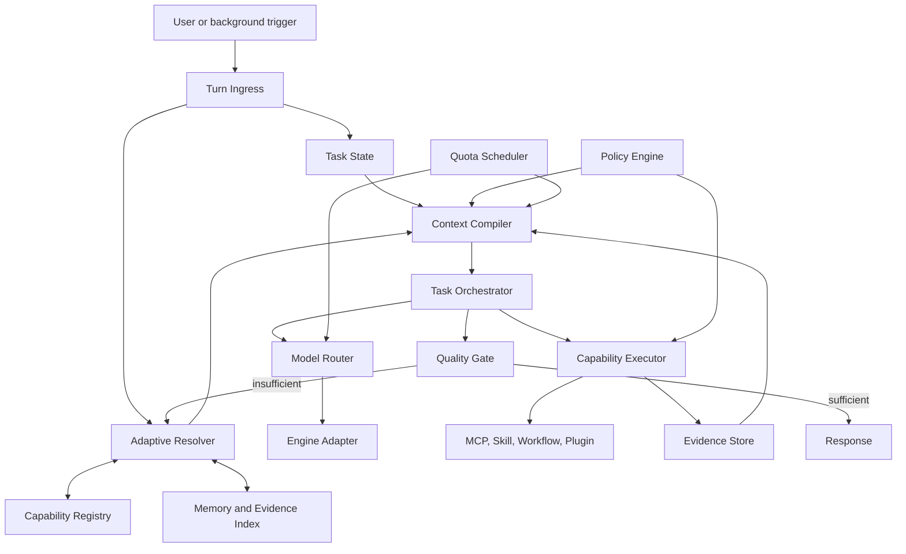
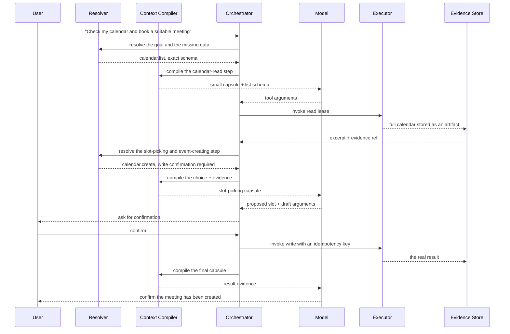

# Adaptive Context Runtime for Jarvis 007

Date: 2026-08-01
Status: **Code for Phases 0-9 is complete; Phases 0-4 run in `shadow`, and the Phase 5-9 canaries are off by default**
Scope: dashboard, Telegram, API engines, Claude/Codex CLI, background tasks, workflows and MCP Hub

Roadmap revision: 2026-08-01. Minimal Task State, trace security and the quota ledger moved to the front; multi-round read-only, write tools, workflows, agents and model routing were split into independent phases.

Implementation progress as of 2026-08-01:

- Done: `task_id`/`step_id`, event envelope, SQLite `runtime.db`, revision pinning, optimistic version guard, budget/deadline envelope, evidence refs that store only a hash, and observe-only quota reservation.
- Done: a shared trace attached to the dashboard and Telegram for the API, Claude CLI and Codex CLI, without changing the prompt, model, tool list or dispatch.
- Token attribution stores only size measurements; raw prompts, messages, tool arguments/results, secrets and source refs are never written to the runtime store.
- Done: a synthetic gold fixture, a prompt-contract baseline and regression tests for lifecycle, privacy, multi-round usage, quota reconciliation and version conflicts.
- Done: a SQLite Capability Registry derived per brain/source, with FTS5, schema hash, stable ID/revision, ModelProfile, integrity check and automatic quarantine/rebuild when the database is corrupted.
- The deterministic Resolver already applies hard filters for brain, health, source, permission and side effect; only then does it score alias/FTS/coverage and apply a dynamic cutoff. Embedding is only an adapter that measures extra recall.
- Registry refresh and the Resolver run in a background thread and write only a redacted `resolver.shadow` into the task trace; they do not change the tool list sent to the model.
- Local synthetic benchmark with 5,000 capabilities: rebuild takes about 2.7 seconds in the background; resolve has a median of about 8.4 ms and a p95 of about 12.6 ms once the revision is cached.
- Context Compiler shadow now has `ContextItem`, a budget per ModelProfile/adapter, a renderer and a swappable tokenizer adapter, observe-only quota preflight, a source map/hash, and an explanation of which capabilities were selected or dropped.
- The core contract shadow does not embed the entire MEMORY, the skill index or the capability catalog; production memory and history are still managed by legacy code in Phase 4.
- The Deterministic Quality Gate records a baseline on the legacy output of the Dashboard and Telegram, without editing or blocking answers.
- Local synthetic benchmark with a 5,000-capability Registry and one selected capability: a 415-token capsule, compile median about 1.0 ms and p95 about 1.6 ms.
- Phase 5 Fast Path now has a conservative classifier, a stable session hash, task path pinning, a registry freshness/revision gate, a versioned hard-quota profile, atomic rolling-window admission and a direct API stream with exactly one model call.
- Fast Path does not read the legacy system prompt, MEMORY, history or tool schemas. Requests that involve tools, live data, side effects, memory, attachments or any uncertainty still go through legacy before the model call.
- Local benchmark of 250 pure-chat tasks covering resolve + compile + pin + SQLite quota admission: median 5.4 ms, p95 7.8 ms, median capsule 401 tokens; about 97% smaller than `CLAUDE.md + MEMORY.md` alone under the same estimator, not counting legacy history and tool schemas.
- The default configuration is still `mode=shadow`, `allocation_basis_points=0` and no quota profile. So merging the Phase 5 code does not move any real user onto the new path.
- Phase 6 now has a single-step read-only path independent of the old tool loop: the resolver accepts only the effects `none/read`, the compiler exposes exactly one schema, the model builds arguments in exactly one round, and the gateway validates them against JSON Schema and then calls the route through a single-use lease.
- Read results are redacted, encrypted into an artifact and stored with `evidence://` provenance; the second model round receives only the current objective plus a bounded excerpt. The Quality Gate requires an evidence ref and blocks claims of write actions on the read-only path.
- The schema is re-checked against read-only discovery right before the model call. If the revision has drifted, the runtime force-refreshes the inventory, rebases the task when no invocation exists yet, and resolves again; if the schema is still unstable it falls back to legacy without running the stale schema.
- Admission reserves quota for both rounds combined before sending the request. Timeouts, wrong arguments, a wrong tool-call contract and unavailable evidence encryption all fail closed, with no automatic replan or replay through the eight-round MCP loop.
- The Phase 6 rollout has its own allocation and capability-group allowlist. By default `readonly_canary.allocation_basis_points=0` and `capability_profiles=[]`; a multi-action tool additionally requires static argument constraints before a lease is granted.
- Phase 7 now has a planner that receives only summary manifests; exact schemas are loaded only in the argument round of each read step. The DAG allows only `none/read`, steps with no dependencies run in parallel up to `max_parallel`; write intents and conversation references still go to legacy.
- Structured Task State holds the revision pin, logical steps, budget, failure signature and evidence map; both the objective and the state are encrypted. Append-only checkpoints are written before tool I/O and after each layer, while events keep only metadata/hashes.
- Resume runs only when the actor, runtime, policy, Registry, model and quota rule are still at the pinned revision. The runtime reconciles the invocation/evidence ledger first; a read step that already has a valid artifact is not called again after a restart.
- Tokens, latency, model round count and monetary budget are checked at the task level; rolling TPM still gates admission before each model batch. The loop stops when evidence is sufficient, the budget/deadline is exhausted, no capability remains, failures repeat, or marginal information gain is low.
- Phase 7 has an `orchestrator_canary` and an independent allowlist, with default allocation `0` and empty profiles. A quota rule must declare both the limit and the real unit price; if monetary metadata is missing it fails closed to legacy before any model/tool call.
- Phase 8 now has three independent sources sharing the Compiler: conversation state with transcript refs, a MemoryIndex with file/line refs plus widening/conflict fallback, and a manifest-only SkillSource that loads exactly one body after resolve.
- The three Phase 8 canaries have their own buckets/rollback, a shared hard-quota gate and default allocation 0. The memory files and the original transcript remain the source of truth; the SQLite state/index is only a projection that can be rebuilt.
- Phase 0, Phase 3 and Phase 4 count as having **passed the release gate** only after enough redacted production samples exist, usage/tokenizer figures have been reconciled against the real ones, and the owner has approved the baseline and critical misses. So Phases 5-8 are not yet allowed to affect real requests.

## Re-review of Phases 0-8 (2026-08-02)

Before opening Phase 9, all of Phases 0-8 were reviewed again slice by slice. Result: the architecture is going the right way (derived stores, content-addressed ID/revision, hard filters enforced in code, append-only checkpoints with OCC, fail-closed defaults), but a group of bugs had to be fixed before touching write.

Fixed in this round:

- **The Phase 0-8 tests never ran in CI.** CI runs each test file as a script (`python tests/python/test_x.py`); eight test files written in pytest style had no `__main__` block, so they only defined functions and exited 0. A runner was added for each file and `pytest` is now installed in the workflow. 100 tests now actually run.
- **Wrongly typed settings crashed the chat turn.** `ObserveRuntime._policy` and `FeaturePolicy.from_settings` parsed outside a try/except; a wrongly typed value in `settings.json` raised all the way up to the websocket loop. Parsing now fails closed to `off`/default.
- **Shadow/canary broke turns that had succeeded.** `_record_quality_shadow` and the Phase 5/6/7/8 `prepare` steps had no exception boundary; an error in an observation branch turned a successful turn into an error report. Every branch is now wrapped and falls back to legacy.
- **The quota ledger swallowed real usage.** A reservation whose TTL ran out mid-stream was flipped to `EXPIRED`, and `consume_quota`/`record_usage` skipped it, so the real tokens vanished from the rolling window (precisely for the longest and most expensive turns). It can now reconcile the `EXPIRED` state too.
- **The Compiler budget contradicted preflight.** `task_tokens_remaining` did not subtract the output reserve, so a `compiled` capsule could still get `would_reject` from preflight. A declared context window smaller than the output reserve also fell back to a fallback LARGER than the real window.
- **The Quality Gate wrongly blocked data narration.** The old regex caught every "đã gửi/đã tạo" phrase ("already sent/already created"), so valid email/calendar summary sentences were replaced by a block notice. It now catches only action claims by the assistant itself, and also covers passive forms ("đã được gửi", "was created"). The `Nguồn:` ("Source:") footer moved to AFTER scoring so the citation check is no longer dead code.
- **The classifier lost Vietnamese signals.** NFKD does not decompose `đ`, so the ASCII deny-patterns (`dinh kem` "attachment", `dat lich` "book a schedule", `dang bai` "publish a post") never matched real Vietnamese sentences. `đ→d` is now mapped in all four modules that use `_norm`, and denies were added for URLs, conversation references and relative time periods.
- **Registry.** The `plugin` source was not in the sweep, so after a plugin was removed its ghost capability could still resolve; two tools with the same name caused an `IntegrityError` that rolled back the WHOLE refresh of a brain; the `source_key` index was missing and FTS deletion ran row by row. All three are fixed, and Phase 6-7's `refresh_tools`/`resolve` were moved out of the event loop.
- **The executor allowed parameters outside the contract.** The default JSON Schema lets extra keys through, so the model could smuggle unknown parameters down to the tool. It is now default-deny; only an explicit `additionalProperties: true` lets them through. An invocation close-out was also added for when a turn is cancelled.
- **Evidence store.** `enc:` is now enforced and path escapes are blocked right at the store boundary instead of trusting the caller; redaction now also covers JWTs, AWS/Google keys, secrets in query strings and key names such as `x-api-key`.
- **The memory index returned the wrong fact.** The chunker accumulated line numbers after dropping blank lines, so every chunk from the second one on drifted further off; on a conflict, `_read_detail` read by the drifted ref and REPLACED the correct excerpt with the content of a different fact. Refs now follow the file's real lines, and the index rebuilds itself when `schema_version` changes.
- **The Phase 5 benchmark read user data.** The test read `brains/My Bullet Journal/Memory/MEMORY.md` (which is in `.gitignore`) so it was always red on a clean checkout. It was replaced with a committed synthetic fixture.

Still owed, to be done during or before Phase 9:

- ~~Phase 7 resume compared the pin by LABEL (the quota rule's `id`)~~ **fixed 2026-08-02**: the pin now also holds `quota_rule_hash` (a hash over all the rule's values) and `model_profile_revision`, so changing the price/TPM while keeping the same `id`, or changing the model profile midway, makes resume stop instead of silently using the new values. What remains: the deadline is not extended on resume, so a restart longer than the deadline cannot resume anything.
- `_continue` resets every `RUNNING` step to `PENDING` and then reruns it - correct for read, but exactly the duplicate-execution bug if applied to write. Phase 9 must have an `UNKNOWN` state plus reconcile instead of a blind retry.
- `runtime_invocations` does not yet have `idempotency_key UNIQUE` as spec section 18.6 requires; it currently relies on the single-use lease.
- The failure signature only stops planner loops so far, not failure loops in execution steps.
- Production shadow resolves with `ActorPolicy(mode="full")`, so it cannot measure misses caused by permission - exactly the filter Phase 9 depends on.
- The Compiler does not yet read `conflicts_with`, has no "quantitative facts must have evidence" check, and `QualityDecision` still lacks `missing_evidence`/`suggested_queries` per section 16.3.

## 0. Architecture decision

Jarvis 007 will move from building requests by "concatenating everything that might be useful into the prompt" to a runtime that compiles context for each step of the task.

The invariant goal is:

> The number of capabilities can grow from a few dozen to tens of thousands, but the context of one step grows only with the number of capabilities that step actually needs.

In this document, capability covers MCP tools, builtin tools, plugin tools, skills, workflows, agents, models, memory sources, evidence sources and validators.

The new runtime does not delete the current data sources and does not turn a vector database into the source of truth. The Registry, index, embeddings, summaries and working state are all derived data that can be rebuilt from the original.

It will not be delivered as one big rewrite. The new runtime must run alongside the current path, with a shadow mode, a canary mode and a per-turn fallback.

## 1. Background and current measurements

Measured on the brain `brains/My Bullet Journal` on 2026-08-01:

| Component | Size in characters |
|---|---:|
| The original `CLAUDE.md` of Jarvis 007 | 21,479 |
| `Memory/MEMORY.md` as loaded | 18,723 |
| Capability block and skill router | about 4,600 |
| Complete system prompt | 45,625 |
| 26 tool schemas sent through the API | 17,161 |
| Fixed total before history and the question | about 62,800 |

With each model's tokenizer, the payload above can exceed 12,000 tokens before the model generates an answer. Adding memory, skills, plugins or MCPs can make the context cost grow linearly.

Current join points:

- `server/main.py:266` builds the system prompt from the base rules, memory, capabilities and skills.
- `server/main.py:5481` builds the prompt for the dashboard.
- `server/main.py:5587` stitches the API history through compaction.
- `server/main.py:5590` hands the request to the MCP/tool loop.
- `server/mcp_hub.py:610` discovers every tool.
- `server/engine.py:1077` puts messages and tool schemas into the provider payload.
- `server/compaction.py:100` manages the compacted and not-yet-compacted parts of history.

Parts that can be reused:

- MCP Hub already standardizes routing, permissions and lazy discovery for connectors.
- `compaction.py` already has rolling summaries and a fallback.
- `engine.py` already has provider adapters and a tool loop.
- Skills, workflows, plugins and models already have initial metadata.
- SQLite, FTS5, the usage store and the session store already exist in the system.

## 2. Goals

### 2.1 Functional goals

1. Keep every existing capability of Jarvis 007.
2. Add an MCP, skill, workflow, agent or model without editing the central system prompt.
3. The initial context does not contain the full list of capabilities.
4. Each step receives only the exact schema of the capability chosen for that step.
5. A simple task is still answered in one model call.
6. A complex task is allowed to resolve, execute and replan over several rounds.
7. Full memory is still stored, but the model receives only the relevant evidence.
8. Every action with a side effect must have a policy, an audit trail and protection against duplicate execution.
9. The model can be switched per step without losing task state.
10. Every decision about context, capability and model selection is traceable.

### 2.2 Performance goals

1. Context cost grows with `k`, the number of capabilities used in the current step, and not with the total number of capabilities `N`.
2. The resolver normally runs locally, with no LLM call.
3. Fast path adds no model round compared with today.
4. Independent read-only tools can run in parallel.
5. The total tokens of the whole task are optimized, not just the tokens of the first request.
6. The system tracks TPM, RPM, concurrency, cost and output reserve in real time.

### 2.3 Quality goals

1. No reduction in the ability to find the right tool, skill, workflow or memory.
2. When the resolver is not certain, the system must widen retrieval or fall back, and must not confidently miss.
3. Important facts in an answer must have internal provenance.
4. Tool arguments must be validated against the real schema before running.
5. The model must not be able to decide permissions or exceed policy through prompt content.

## 3. Non-goals

- Do not replace the entire current database with a vector database.
- Do not move the original memory into a proprietary format.
- Do not force every question through a multi-round agent loop.
- Do not create a separate hardcoded prompt for each provider.
- Do not remove Claude/Codex native sessions.
- Do not merge the dashboard, Telegram, background tasks and workflows into one refactor all at once.
- Do not let the LLM decide permissions, quotas or side effects.
- Do not delete the current fallback before the benchmark replay meets the requirements.

## 4. Invariant principles

### 4.1 Context must have a nearly fixed structural size

The core prompt describes only the working protocol, a minimal identity and the constraints needed for the current step. It does not list all memory, skills, workflows or tools.

Adding 1,000 new capabilities to the Registry must not automatically add 1,000 lines to the prompt.

### 4.2 The source of truth lives outside the model

- Memory, skill and workflow files are the source of truth for content.
- The MCP server is the source of truth for tool schemas.
- Settings and the model catalog are the source of truth for provider configuration.
- The Registry and index are only derived copies.
- Task state and evidence must exist outside the model's context.

### 4.3 Exact schema at execution time

The model may generate arguments only for the full schema that was selected and placed in the current step's capsule. The model is not asked to guess parameters from a tool name or a shortened description.

### 4.4 Enforcement at the gateway

Permission, confirmation, rate limit, path scope, idempotency and side-effect policy must be enforced by code. The prompt only helps the model behave well; it is not the final safety barrier.

### 4.5 Adaptive instead of hardcoded counts

Do not use a fixed number such as "always take 5 memories", "always keep 12 messages" or "always expose 8 tools" as the main logic.

The runtime chooses quantities based on:

- the remaining token budget;
- retrieval confidence;
- the score gap between candidates;
- how much of the goal is covered;
- the risk of the action;
- the expected value of the information;
- the current cost and latency.

Absolute limits are only configurable safety ceilings, not the algorithm for choosing context.

## 5. Terminology

| Term | Meaning |
|---|---|
| Capability | An ability that can be discovered, described or invoked |
| Manifest | Standardized metadata of a capability |
| Registry | The store of manifests and versions, not placed in the prompt |
| Resolver | The component that finds the capability that fits a goal |
| Context item | A unit of content with a source, a value score and a token cost |
| Context capsule | Context compiled for exactly one step |
| Task | A goal spanning one or more rounds |
| Step | One reasoning or execution pass within a task |
| Evidence | Sourced data supplied by memory, files or tools |
| Artifact | A full result stored outside the prompt and referenced by ID |
| Quality gate | The evaluator of whether a task has enough evidence to answer |
| Shadow mode | The new runtime computes decisions but the old path still executes |

## 6. Overall architecture



## 7. Capability Registry

### 7.1 Role

The Registry provides one unified interface for:

- MCP tools from every connection;
- builtin tools in Jarvis 007;
- plugin tools;
- skills;
- workflows and agents;
- models/providers;
- memory collections;
- validators and transformers.

The Registry must not concatenate all manifests into the system prompt.

The long-term scope of the Registry is all of the types above. The MVP ingests only MCP tools, builtin tools, plugin tools and a minimal ModelProfile. Skills, workflows, agents and memory collections come in after the tool path has proven it works. This split avoids designing a universal manifest too early without a real consumer.

### 7.2 Capability manifest

First-version logical schema:

```python
@dataclass(frozen=True)
class CapabilityManifest:
    id: str
    revision: str
    kind: str
    name: str
    summary: str
    intents: list[str]
    aliases: list[str]
    input_schema: dict
    output_schema: dict | None
    permissions: list[str]
    side_effect: str
    risk: str
    provider: str | None
    dependencies: list[str]
    constraints: dict
    cost_hint: dict
    latency_hint: dict
    cache_policy: dict
    health: dict
    examples: list[dict]
    source_ref: str
    source_hash: str
    metadata: dict
```

Conventions:

- `id` is stable and namespaced, for example `mcp.google-calendar.create-event`.
- `revision` changes when the schema or behavior changes.
- `side_effect` is one of `none`, `read`, `write`, `dangerous`.
- `source_ref` points to the original MCP connection, skill file, workflow or model adapter.
- `source_hash` is used for invalidation and replay.
- A manifest contains no secrets.

### 7.3 Storage

Use SQLite in `JAVIS_STATE_DIR`, for example `capabilities.db`:

```sql
CREATE TABLE capabilities (
    id TEXT PRIMARY KEY,
    revision TEXT NOT NULL,
    kind TEXT NOT NULL,
    manifest_json TEXT NOT NULL,
    source_ref TEXT NOT NULL,
    source_hash TEXT NOT NULL,
    enabled INTEGER NOT NULL,
    updated_at REAL NOT NULL
);

CREATE TABLE capability_aliases (
    capability_id TEXT NOT NULL,
    alias TEXT NOT NULL
);

CREATE TABLE capability_dependencies (
    capability_id TEXT NOT NULL,
    dependency_id TEXT NOT NULL,
    relation TEXT NOT NULL
);

CREATE TABLE capability_stats (
    capability_id TEXT PRIMARY KEY,
    success_count INTEGER NOT NULL,
    failure_count INTEGER NOT NULL,
    latency_ema REAL,
    last_error TEXT,
    last_used_at REAL
);
```

The FTS5 index covers name, summary, intent, alias and examples. The embedding index is an optional adapter, not a boot requirement.

### 7.4 Ingestion adapter

Each source implements an adapter:

```python
class CapabilitySource(Protocol):
    async def snapshot(self) -> SourceSnapshot: ...
    async def manifests(self, snapshot: SourceSnapshot) -> AsyncIterator[CapabilityManifest]: ...
```

Minimum sources:

- `MCPSource`: turns the `tools/list` result into manifests.
- `BuiltinSource`: registers builtin tools and policy.
- `PluginSource`: reads the plugin manifest and tool registration.
- `SkillSource`: reads the frontmatter and source path, and does not read the whole skill body into the Registry.
- `WorkflowSource`: reads input, output, trigger and dependency.
- `ModelSource`: reads the model catalog and provider capabilities.
- `MemorySource`: registers collections, and does not turn each fact into a tool.

Order of rolling out source adapters:

1. MCP, builtin and plugin tools.
2. A minimal ModelProfile for the compiler and quota preflight to use.
3. Skill and memory collection once the read-only tool path is stable.
4. Workflow and agent once the Task Orchestrator has checkpoint/resume.

### 7.5 Sync and invalidation

- The Registry is updated in the background when a source hash changes.
- A chat request does not wait for a full rescan if a valid snapshot exists.
- If a source fails, keep the latest good revision and mark it degraded.
- If the Registry is corrupted, the derived database can be deleted and rebuilt.
- Changing one source invalidates only the capabilities belonging to that source.

### 7.6 Extension points

The core does not directly import each new connector, model or workflow. Extensions register through an interface:

```python
@dataclass
class RuntimeExtension:
    name: str
    version: str
    sources: list[CapabilitySource]
    executors: dict[str, CapabilityExecutor]
    model_adapters: list[ModelEngine]
    context_sources: list[ContextSource]
    policy_providers: list[PolicyProvider]
    validators: list[QualityValidator]
```

Registration rules:

- Each extension has its own namespace.
- A duplicate capability ID is an error; a new extension is not allowed to silently shadow another.
- An extension can add a new kind but must declare the matching renderer and executor.
- An extension must not write directly into the Registry database; it only emits manifests through a source adapter.
- Unloading an extension turns its capabilities disabled/degraded, and does not delete the audit trail or task history.
- The runtime extension API is versioned; import side effects are not used as an implicit contract.

Adding a new MCP needs only a connection and `tools/list`. Adding a new model needs only a ModelProfile source and an engine adapter. Adding a new workflow needs only a manifest and a graph source. In no case is a change to the core prompt required.

## 8. Adaptive Resolver

### 8.1 Input and output

```python
@dataclass
class ResolveRequest:
    task_id: str
    objective: str
    active_state: dict
    available_inputs: list[DataRef]
    required_outputs: list[DataContract]
    channel: str
    brain: str
    actor: ActorContext
    model_profile: ModelProfile | None
    policy_context: dict

@dataclass
class ResolveResult:
    candidates: list[ResolvedCapability]
    coverage: dict
    confidence: float
    unresolved: list[str]
    recommended_path: str
    trace_id: str
```

`recommended_path` can be `fast`, `tool`, `workflow`, `agentic`, `ask_user` or `fallback_legacy`.

### 8.2 Search pipeline

1. Decompose the objective into data and action needs.
2. Hard-filter by enabled, permission, channel, brain, dependency and health.
3. Fetch candidates through FTS, alias, the semantic index and the dependency graph.
4. Boost capabilities that previously succeeded on a similar intent.
5. Penalize capabilities that are failing, slow, quota-hungry or need a permission that is not yet granted.
6. Compute the coverage of the whole objective, not just each tool's score.
7. Choose the candidate set by marginal utility instead of a fixed top-k.

Conceptual score:

```text
utility = relevance
        × confidence
        × health
        × permission_fit
        × output_fit
        × freshness
        - latency_cost
        - token_cost
        - monetary_cost
        - risk_cost
```

The weights belong to `ResolverPolicy`, are versioned, and can change without editing manifests.

The first version of the Resolver must be deterministic and explainable. It uses hard filters, alias, FTS, coverage and score gap. Embedding only adds recall when FTS is not enough. It does not yet learn weights online and does not yet boost strongly by how often a capability was chosen before, because that mechanism easily creates a popularity loop that gives new capabilities no chance to appear.

### 8.3 Dynamic cutoff

The Resolver stops adding candidates when all of these conditions hold:

- the required needs are covered;
- the next candidate does not raise coverage meaningfully;
- the score gap shows the choice is already clear;
- the token cost of the next schema is larger than its expected value;
- confidence reaches the level required by the risk class.

When confidence is low:

- widen the query with aliases or graph neighbors;
- look for a workflow instead of a single tool;
- ask a planner model with a small capsule;
- ask the user again if there are several different write actions;
- fall back to the current path or to a model with a larger budget.

### 8.4 Shadow mode

In shadow mode:

- The Resolver records candidates and confidence.
- The current path still receives the full prompt/tools as before.
- After the turn, the trace compares the tools actually called against the candidates.
- No shadow decision is allowed to run a tool or replace the answer.

Shadow replay is a mandatory gate before canary, but the old behavior is not treated as the only correct label. Evaluation needs two sets:

- Automatic replay to detect differences from the current path.
- A gold benchmark where a human reviewer marks the correct capability, evidence and result.

If the new Resolver picks a workflow or capability that is better than the old path, the benchmark must record it as an improvement rather than a mismatch.

## 9. Model Registry and Quota Scheduler

### 9.1 Model profile

```python
@dataclass(frozen=True)
class ModelProfile:
    provider: str
    model: str
    context_window: int | None
    input_tpm: int | None
    output_tpm: int | None
    rpm: int | None
    supports_tools: bool
    supports_parallel_tools: bool
    supports_vision: bool
    supports_reasoning: bool
    supports_prompt_cache: bool
    tokenizer: str | None
    pricing: dict
    reliability: dict
```

A profile is merged from:

- a versioned default catalog;
- live provider metadata, if available;
- user overrides;
- observed usage and errors.

No single source is trusted absolutely. Every field has provenance and an update time.

### 9.2 Quota snapshot

The Quota Scheduler maintains a sliding window per actor, provider and model:

```python
@dataclass
class QuotaSnapshot:
    input_tokens_used: int
    output_tokens_used: int
    requests_used: int
    inflight_reserved_tokens: int
    reset_at: float | None
    confidence: float
```

Before sending a request:

1. The tokenizer adapter counts the expected request.
2. If there is no exact tokenizer yet, the estimator uses the error learned from real usage plus a safety margin.
3. The Scheduler reserves tokens atomically.
4. When the provider returns usage, the reservation is reconciled.
5. On an error before generation, the reservation is released according to the provider policy.

### 9.3 Model routing

The Model Router picks a model for each step based on:

- the output contract;
- the tool/vision/reasoning requirement;
- the remaining context and quota;
- the deadline and latency;
- the risk and quality requirement;
- the remaining task cost;
- live reliability.

Do not switch models just to save money if the switch loses a needed capability.

## 10. Context Compiler

### 10.1 Context item

Every piece of content that can enter the prompt must be normalized:

```python
@dataclass(frozen=True)
class ContextItem:
    id: str
    kind: str
    content: str
    source_ref: str
    token_cost: int
    relevance: float
    confidence: float
    authority: float
    freshness: float
    required: bool
    trust: str
    scope: dict
    conflicts_with: list[str]
    metadata: dict
```

The initial `kind` values:

- `core_contract`;
- `policy_clause`;
- `identity_fact`;
- `memory_fact`;
- `conversation_state`;
- `recent_turn`;
- `evidence_excerpt`;
- `capability_schema`;
- `workflow_contract`;
- `channel_context`;
- `user_attachment`;
- `output_contract`.

### 10.2 Budget

```python
@dataclass
class ContextBudget:
    max_input_tokens: int
    reserved_output_tokens: int
    task_tokens_remaining: int
    rolling_tpm_remaining: int | None
    latency_deadline_ms: int | None
    monetary_remaining: float | None
```

`max_input_tokens` is computed from the model profile, the quota snapshot, the task budget and the output reserve. It does not sit in one shared constant for every model.

### 10.3 Compile algorithm

1. Load the smallest required items: objective, output contract, applicable policy and active state.
2. Drop items for the wrong brain, wrong actor, expired, or without enough trust.
3. Merge duplicate items by source hash.
4. Detect conflicts and keep both if a conflict is not yet resolved.
5. Pick items with high utility per token until coverage is sufficient or marginal utility is no longer reasonable.
6. If a required item pushes the request over budget, do not cut silently. Return a decision of `recompile`, `change_model`, `defer`, `ask_user` or `fallback`.
7. Render the capsule using the model's adapter.
8. Count tokens one last time on the rendered payload, tool schemas included.

Pseudo-code:

```python
def compile_context(request, items, budget, policy):
    chosen = select_required(items, request)
    if token_cost(chosen) > budget.max_input_tokens:
        return CompileFailure.required_items_too_large(chosen)

    pool = normalize_filter_dedupe(items, request, policy)
    while not coverage_sufficient(chosen, request):
        candidate = best_marginal_candidate(pool, chosen, budget, policy)
        if candidate is None:
            break
        chosen.append(candidate)
        pool.remove(candidate)

    capsule = render_capsule(chosen, request)
    return verify_and_finalize(capsule, budget)
```

### 10.4 Context capsule

```python
@dataclass
class ContextCapsule:
    task_id: str
    step_id: str
    objective: str
    active_state: dict
    instructions: list[str]
    evidence: list[EvidenceExcerpt]
    capabilities: list[CapabilityLease]
    constraints: list[Constraint]
    output_contract: dict
    source_map: dict
    budget: ContextBudget
    capsule_hash: str
```

A capsule must have a `source_map` so the trace knows where each statement came from. Do not put a long `source_map` into the model if the adapter does not need it, but it must be stored outside the prompt.

### 10.5 Core contract

The core contract contains only:

- a minimal identity and communication style;
- the rule to follow the capsule;
- the rule not to invent tools or evidence;
- how to report missing data;
- the output contract;
- the instruction that permissions and side effects are controlled by the gateway.

Detailed rules are split into policy clauses and loaded only when the scope matches. Rules that must hold everywhere should be enforced in code where possible.

## 11. Memory and Conversation State

### 11.1 Four memory layers

1. `Event store`: the original conversations, tool events, file events and decisions.
2. `Fact store`: distilled facts, with source, confidence and time.
3. `Relationship index`: links between people, projects, files, tasks and facts.
4. `Working state`: the goals, assumptions, decisions and unfinished work of the current task.

`MEMORY.md` keeps existing during the transition and remains a source users can read. The new runtime does not rely on embedding the whole file.

### 11.2 Memory record

```python
@dataclass
class MemoryRecord:
    id: str
    title: str
    content_ref: str
    excerpt: str
    topics: list[str]
    entities: list[str]
    valid_from: float | None
    valid_to: float | None
    confidence: float
    importance: float
    source_refs: list[str]
    source_hash: str
```

### 11.3 Retrieval cascade

1. The task's active working state.
2. Identity/core facts with a matching scope.
3. Exact keyword and entity match.
4. FTS and semantic retrieval.
5. Graph expansion when coverage is lacking.
6. Read the source file when detail is needed or there is a conflict.

The number of records chosen follows coverage and budget, not a fixed top-k.

### 11.4 Conversation history

A single prose summary is not used as the only source. A session needs three forms of data:

- the original transcript in `conversations.db`;
- structured conversation state;
- a derived summary for quick reading.

Minimum structured state:

```json
{
  "goals": [],
  "decisions": [],
  "open_questions": [],
  "constraints": [],
  "artifacts": [],
  "entities": [],
  "last_completed_step": null
}
```

When the compiler needs a detail missing from the state, it can trace back to the transcript through a source ref.

## 12. Evidence Store

### 12.1 Purpose

Tool results, file contents and large data are stored outside the prompt. The model receives only the relevant excerpt and the artifact ID.

Example:

```text
evidence://task/01J4.../step/03/google-calendar-events
```

### 12.2 Evidence object

```python
@dataclass
class Evidence:
    id: str
    task_id: str
    step_id: str
    source_type: str
    source_ref: str
    content_type: str
    artifact_path: str | None
    inline_excerpt: str
    content_hash: str
    trust: str
    created_at: float
    expires_at: float | None
    metadata: dict
```

### 12.3 Rules

- The full result is stored as is, or normalized into an artifact.
- Secrets must be redacted before indexing or tracing.
- An excerpt must keep the source location, row, page or JSON path if there is one.
- Read-only evidence can be cached by manifest policy and input hash.
- A write response must not be served from cache to assume the action has run.
- A large artifact must have pagination or a query interface.

## 13. Task Orchestrator

### 13.1 Task state machine

```text
CREATED
  -> RESOLVING
  -> COMPILING
  -> MODEL_RUNNING or EXECUTING
  -> EVALUATING
  -> COMPLETED
  -> WAITING_USER
  -> RETRYABLE_ERROR
  -> FAILED
  -> CANCELLED
```

Each state transition is stored atomically and emits an event carrying `task_id`, `step_id` and `attempt`.

### 13.2 Task state

```python
@dataclass
class TaskState:
    task_id: str
    session_id: str
    brain: str
    channel: str
    actor: ActorContext
    objective: str
    status: str
    active_state: dict
    evidence_refs: list[str]
    capability_leases: list[str]
    token_budget: dict
    quota_reservations: list[str]
    steps: list[StepRef]
    version: int
    runtime_version: str
    resolver_policy_version: str
    compiler_policy_version: str
    registry_revision: str
    model_profile_revision: str
    created_at: float
    updated_at: float
```

`version` is used for optimistic concurrency control. A step that finishes on an old state version must not overwrite a newer state. The five revision fields are pinned when the task is created; a task does not jump to a new runtime, policy, Registry or model metadata midway.

### 13.3 Three execution paths

#### Fast path

Applies when no live data is needed, there is no side effect, and the Context Compiler already has enough evidence.

```text
resolve local -> compile -> one model call -> quality gate -> response
```

#### Tool path

Applies when a clearly defined group of capabilities is needed.

```text
resolve local -> compile exact schemas -> model tool call
-> validate -> execute -> evidence -> compile final -> response
```

If the objective and arguments can be determined safely by the gateway, it can execute before the model and use the model only to synthesize.

#### Agentic path

Applies when the objective has many steps or dependencies, or the resolver does not have enough coverage.

```text
plan -> resolve step -> compile -> execute -> evidence
-> evaluate -> replan or finalize
```

### 13.4 Conditions for opening a new round

Open a new step only when one of these conditions is true:

- the output contract is not yet satisfied;
- required evidence is still missing;
- a conflict is unresolved;
- a tool requires a follow-up;
- a validator returned a fixable error;
- the model returned a specific data need that can be resolved.

Do not open a new round just because the model says in general terms that it wants to "look further".

### 13.5 Stop conditions

- The objective is met and the Quality Gate passes.
- Marginal information gain is lower than the cost of continuing.
- The task budget or deadline is exhausted.
- A new permission or confirmation is needed.
- No suitable healthy capability remains.
- The same failure signature repeats according to the retry policy.

### 13.6 Parallel execution

- Only independent `none` or `read` capabilities run in parallel.
- The dependency graph must prove they do not need each other's output.
- Write tools run sequentially by default.
- Two writes to the same resource lock key must not run in parallel.
- Parallel results are stored as separate evidence and only then merged.

### 13.7 Sample multi-round sequence



In the second round, the model does not receive the full calendar JSON again. It receives the selected excerpt and the evidence ref. If it needs to check another slot, the compiler reads exactly the needed part of the artifact.

## 14. Capability Executor and side effects

### 14.1 Capability lease

The Resolver does not grant permanent execution rights. The Orchestrator creates a lease:

```python
@dataclass
class CapabilityLease:
    lease_id: str
    capability_id: str
    revision: str
    task_id: str
    step_id: str
    actor_id: str
    allowed_effect: str
    resource_scope: dict
    expires_at: float
```

The Executor rejects an invocation if the revision, scope, actor or expiry does not match.

### 14.2 Idempotency

Every write invocation has:

```text
idempotency_key = hash(task_id, logical_action_id, capability_id, normalized_args)
```

The Executor stores:

```text
PREPARED -> RUNNING -> SUCCEEDED
                    -> FAILED_RETRYABLE
                    -> FAILED_FINAL
                    -> UNKNOWN
```

If the state is `UNKNOWN`, the write is not retried automatically. It must be reconciled with a read tool or by asking the user.

### 14.3 Validation

Before running:

1. Validate JSON Schema.
2. Validate permission and mode.
3. Validate resource scope.
4. Validate the confirmation requirement.
5. Validate idempotency.
6. Validate quota and rate limit.
7. Write the PREPARED audit record.

## 15. Workflows and agents as capabilities

Extended workflow manifest:

```python
@dataclass(frozen=True)
class WorkflowManifest:
    capability: CapabilityManifest
    input_contract: dict
    output_contract: dict
    graph_ref: str
    resumable: bool
    compensation: dict
    max_risk: str
```

A workflow graph has these nodes:

- capability invocation;
- model step;
- condition;
- parallel group;
- wait user;
- checkpoint;
- compensation.

A workflow can call another workflow by capability ID. Dependencies are resolved by revision, and the content of a child workflow is not copied into the prompt.

An agent is a workflow that may replan on its own within the policy and the task budget it was granted. An agent does not get access to every capability by default.

## 16. Quality Gate

The Quality Gate is implemented in two layers. The deterministic layer appears from the fast path and the read-only tool path. A model validator is added only after deterministic checks are not enough and the task budget allows. Quality is not checked only once the tool write phase arrives.

### 16.1 Input

The Quality Gate receives:

- the objective;
- the output contract;
- the active state;
- the evidence map;
- a draft answer or planned action;
- unresolved items;
- the risk class.

### 16.2 Deterministic checks first

- Are all required fields present?
- Do quantitative facts have evidence?
- Is there an unresolved conflict?
- Did a write tool succeed, or was it only proposed?
- Does the answer claim more than the evidence supports?
- Is the output in the right schema/channel?

Use a model validator only when deterministic checks are not enough and the value of the check exceeds its cost.

### 16.3 Result

```python
@dataclass
class QualityDecision:
    status: str  # pass, revise, gather_more, ask_user, fail
    reasons: list[str]
    missing_evidence: list[str]
    suggested_queries: list[str]
    confidence: float
```

## 17. Policy Engine

The Policy Engine decides:

- which capabilities an actor may see;
- whether an action needs confirmation;
- the path/file/resource scope;
- which data may be sent to which provider;
- which evidence contains sensitive data;
- which capabilities may run in parallel;
- retry and compensation for side effects;
- which model/provider may be used with the current data.

Policy is versioned data or tested code, and must not be buried in a long system prompt.

Tool descriptions and tool results are always treated as untrusted content. They cannot edit policy on their own.

## 18. Internal interfaces

### 18.1 Runtime entry point

```python
class AdaptiveRuntime:
    async def run_turn(self, request: TurnRequest, sink: TurnSink) -> TurnResult: ...
    async def resume_task(self, task_id: str, input: UserInput | None, sink: TurnSink) -> TurnResult: ...
    async def cancel_task(self, task_id: str) -> None: ...
```

`TurnRequest` holds the channel, session, brain, actor, user content, attachment refs and model preference. It does not hold the full system prompt.

### 18.2 Resolver

```python
class CapabilityResolver:
    async def resolve(self, request: ResolveRequest) -> ResolveResult: ...
```

### 18.3 Compiler

```python
class ContextCompiler:
    async def compile(self, request: CompileRequest) -> CompileResult: ...
```

### 18.4 Executor

```python
class CapabilityExecutor:
    async def invoke(self, lease: CapabilityLease, args: dict) -> InvocationResult: ...
```

### 18.5 Engine adapter

```python
class ModelEngine(Protocol):
    async def count_tokens(self, request: ModelRequest) -> TokenEstimate: ...
    async def generate(self, request: ModelRequest) -> AsyncIterator[ModelEvent]: ...
```

A provider adapter does not build context on its own and does not discover tools on its own.

### 18.6 Persistence schema

Runtime state uses transactional SQLite. In the first version it can live in a new database `runtime.db` so it can be rolled back independently of `conversations.db`.

```sql
CREATE TABLE runtime_tasks (
    id TEXT PRIMARY KEY,
    session_id TEXT NOT NULL,
    brain TEXT NOT NULL,
    channel TEXT NOT NULL,
    actor_json TEXT NOT NULL,
    objective TEXT NOT NULL,
    status TEXT NOT NULL,
    active_state_json TEXT NOT NULL,
    budget_json TEXT NOT NULL,
    version INTEGER NOT NULL,
    runtime_version TEXT NOT NULL,
    resolver_policy_version TEXT NOT NULL,
    compiler_policy_version TEXT NOT NULL,
    registry_revision TEXT NOT NULL,
    model_profile_revision TEXT NOT NULL,
    created_at REAL NOT NULL,
    updated_at REAL NOT NULL
);

CREATE TABLE runtime_steps (
    id TEXT PRIMARY KEY,
    task_id TEXT NOT NULL,
    ordinal INTEGER NOT NULL,
    attempt INTEGER NOT NULL,
    status TEXT NOT NULL,
    objective TEXT NOT NULL,
    capsule_hash TEXT,
    model_ref TEXT,
    input_tokens INTEGER,
    output_tokens INTEGER,
    started_at REAL,
    completed_at REAL,
    error_code TEXT,
    FOREIGN KEY(task_id) REFERENCES runtime_tasks(id)
);

CREATE TABLE runtime_events (
    seq INTEGER PRIMARY KEY AUTOINCREMENT,
    task_id TEXT NOT NULL,
    step_id TEXT,
    event_type TEXT NOT NULL,
    payload_json TEXT NOT NULL,
    created_at REAL NOT NULL
);

CREATE TABLE runtime_evidence (
    id TEXT PRIMARY KEY,
    task_id TEXT NOT NULL,
    step_id TEXT NOT NULL,
    source_type TEXT NOT NULL,
    source_ref TEXT NOT NULL,
    content_type TEXT NOT NULL,
    artifact_path TEXT,
    excerpt TEXT NOT NULL,
    content_hash TEXT NOT NULL,
    trust TEXT NOT NULL,
    metadata_json TEXT NOT NULL,
    created_at REAL NOT NULL,
    expires_at REAL
);

CREATE TABLE runtime_invocations (
    id TEXT PRIMARY KEY,
    idempotency_key TEXT NOT NULL UNIQUE,
    task_id TEXT NOT NULL,
    step_id TEXT NOT NULL,
    capability_id TEXT NOT NULL,
    capability_revision TEXT NOT NULL,
    args_hash TEXT NOT NULL,
    status TEXT NOT NULL,
    result_evidence_id TEXT,
    provider_request_id TEXT,
    error_code TEXT,
    created_at REAL NOT NULL,
    updated_at REAL NOT NULL
);

CREATE TABLE quota_reservations (
    id TEXT PRIMARY KEY,
    task_id TEXT NOT NULL,
    step_id TEXT NOT NULL,
    provider TEXT NOT NULL,
    model TEXT NOT NULL,
    input_reserved INTEGER NOT NULL,
    output_reserved INTEGER NOT NULL,
    status TEXT NOT NULL,
    expires_at REAL NOT NULL,
    created_at REAL NOT NULL
);
```

Transaction requirements:

- Create the step and change the task status in the same transaction.
- Claim an invocation by its unique idempotency key before calling a write tool.
- Update the task with `WHERE version = expected_version`; if the update fails, reload and merge/replan.
- Events are append-only, never updated. Large payloads live in the Evidence Store, and events keep only a ref.
- Expired reservations are reclaimed by a reconciler, and do not depend on process memory.

### 18.7 Channel event compatibility

The runtime emits a standard internal event:

```python
@dataclass
class RuntimeEvent:
    type: str
    task_id: str
    step_id: str | None
    channel_payload: dict
    trace_payload: dict
```

`TurnSink` converts events into the current protocol:

| Runtime event | Current Dashboard/Telegram |
|---|---|
| `task.status` | `status` |
| `model.delta` | `stream` |
| `capability.started` | `tool_call` |
| `capability.finished` | `tool_result` or trace only |
| `task.completed` | `response` |
| `task.failed` | `error` |
| `task.waiting_user` | the existing question/ask block |

The old frontend does not need to understand the Registry, capsules or evidence to keep showing the chat. The `task_id` and `step_id` fields are added in a backward-compatible way.

## 19. Integration with current code

### 19.1 New modules

```text
server/
  capability_registry.py
  capability_sources.py
  capability_resolver.py
  context_items.py
  context_compiler.py
  task_runtime.py
  task_state.py
  evidence_store.py
  policy_engine.py
  model_registry.py
  model_router.py
  quota_scheduler.py
  quality_gate.py
```

It is not necessary to create all files at once. Split by phase and create an abstraction only when at least one real path uses it.

### 19.2 `mcp_hub.py`

Keep:

- connection resolution;
- the permission guard;
- route invocation;
- the connector adapter;
- the existing audit and rate limit.

Add:

- manifest snapshot export;
- source revision;
- an executor route by capability ID and revision;
- background refresh;
- no discovering everything in the hot path while the snapshot is still valid.

The current lazy tool becomes a fallback during the transition.

### 19.3 `engine.py`

Keep:

- the provider HTTP adapter;
- event parsing;
- tool call parsing;
- usage collection.

Move out gradually:

- the decision of which tool to expose;
- multi-round orchestration;
- quota reservation;
- the task stop condition;
- policy and idempotency.

In the early phase, `_cc_tool_loop` remains the old executor behind a compatibility adapter.

### 19.4 `compaction.py`

Keep the rolling summary as a fallback. Add structured conversation state and source refs. Do not delete the original transcript.

Later, `prepare_history` becomes a ContextItem source instead of deciding the final payload itself.

### 19.5 `main.py`

In the early phase, only the call point in the dashboard API provider is replaced:

```text
_do_turn
  -> runtime.run_turn if the feature flag is on
  -> the current path if it is off or on fallback
```

Do not refactor the dashboard and Telegram in the same commit. Only after the dashboard is stable, move Telegram, background tasks and reminders onto the same runtime entry point.

### 19.6 CLI engine

Claude/Codex native sessions have their own context management. The new runtime can still use the Resolver, Registry, Evidence and Policy, but the adapter decides what needs to be sent. The CLI is not forced through an OpenAI-style tool schema.

## 20. Configuration and feature flags

```json
{
  "context_runtime": {
    "mode": "off",
    "channels": {},
    "providers": {},
    "canary": {},
    "resolver_policy": "default-v1",
    "compiler_policy": "default-v1",
    "fallback": "legacy"
  }
}
```

`mode`:

- `off`: only the old path.
- `observe`: only token attribution and trace.
- `shadow`: resolve/compile but do not execute the new decisions.
- `canary`: enabled by actor/session/provider policy.
- `on`: the new runtime is the main path, and legacy can still be a fallback.

Canary selection must be stable by session or actor hash, not re-randomized every turn.

When creating a task, the runtime must pin `runtime_version`, `resolver_policy_version`, `compiler_policy_version`, `registry_revision` and `model_profile_revision`. A canary must not change the runtime in the middle of a running task. A source schema that changes midway must produce a revision mismatch and a controlled re-resolve.

Do not put fixed top-k numbers into the Settings UI. The UI only picks a policy profile and shows metrics. The policy details are versioned technical configuration.

## 21. Observability

### 21.1 Mandatory trace

Before turning on the real trace, retention, redaction, encryption-at-rest if needed, view permissions and export rules must be settled. The observation phase must not collect raw secrets or full sensitive artifacts and only then decide how to protect them.

Each task records:

- the normalized objective;
- the resolver query and candidate scores;
- capabilities filtered out, and why;
- context items chosen or dropped;
- the token estimate and the real tokens;
- the model route and why;
- quota reservations;
- redacted tool arguments;
- evidence refs;
- the quality decision;
- fallbacks and retries;
- latency per stage.

### 21.2 Token attribution

Usage must be broken down at a minimum into:

```text
core_contract
policy
memory
conversation_state
recent_turns
evidence
capability_schema
tool_result
user_input
output
```

Also measure:

- the tokens of the first request;
- the total tokens of the whole task;
- the number of model rounds;
- the number of tool rounds;
- the tokens repeated across rounds.

### 21.3 Metrics

- resolver recall on replay;
- capability precision;
- task success rate;
- write duplicate rate;
- fallback rate;
- quality revision rate;
- input/output tokens per task;
- P50/P95 latency of the fast path and the agentic path;
- provider errors by type;
- quota rejections avoided before sending;
- registry freshness and degraded sources.

## 22. Security

1. Manifests contain no credentials.
2. Traces and evidence are redacted with the same protection layer as the current conversation log.
3. Capability search returns only capabilities the actor is allowed to see.
4. The model does not receive secrets to call an MCP directly if the gateway can hold the secret.
5. Sources from the web, MCP and external files are marked with a trust level.
6. Policy clauses have higher precedence than untrusted content.
7. Write tools need a lease and idempotency.
8. Artifact paths must be inside the state dir or an allowed brain scope.
9. Provider routing must take data residency and user policy into account.
10. Replay fixtures must have secrets and personal data removed before commit.

## 23. Failure modes and fallback

| Failure | Behavior |
|---|---|
| Registry unavailable | Use the latest good snapshot or legacy discovery |
| Registry stale | Mark the trace, refresh in the background, never lose a capability on its own |
| Low resolver confidence | Widen retrieval, small planner, ask the user or fall back |
| Compiler over budget | Change model, reduce evidence by utility, split the step or fall back |
| Wrong token estimate | Reconcile usage, update the error model, raise the safety margin |
| Provider out of TPM | Queue, switch model/provider by policy, or report it clearly |
| Tool schema changes between resolve and invoke | Lease revision mismatch, resolve again |
| Read tool timeout | Retry per the manifest or use a valid evidence cache |
| Write tool timeout | Move to UNKNOWN, reconcile, never retry blindly |
| Quality Gate lacks evidence | Resolve more or ask the user |
| Runtime exception | Record the trace and fall back to legacy if no side effect has happened yet |
| Exception after a side effect | Do not fall back and rerun; resume from the task state |

Key principle: fall back to the old path only when it is certain that no unreconciled side effect exists.

Fallback follows the policy order, and does not default to going straight back to legacy on the same provider:

```text
recompile a smaller context
-> split the objective into several steps
-> wait for quota if the deadline allows
-> switch to a model/provider that is capable enough and allowed to receive the data
-> legacy only if the provider still has enough budget
-> report clearly or ask the user
```

After a side effect, fallback may only resume from the Task State and the invocation ledger. The whole turn is not rebuilt through the legacy path.

## 24. Rollout plan, after critique

Each phase proves only one group of hypotheses, and has a feature flag, a release gate and an independent rollback. The new runtime must not take over another kind of task just because the previous phase's code was merged; it may be turned on only when the benchmark for exactly that kind of task meets its gate.

### Phase 0: Measurement net, trace security and benchmark

Implementation status: instrumentation and fixtures exist; the observe-only baseline is being collected, and the phase has not yet passed the release gate that needs owner approval.

Decisions required before collecting production traces:

- which fields may be stored or must be redacted;
- retention for traces, evidence and artifacts;
- view permissions for user/admin;
- the trace export policy;
- which fixtures may be committed;
- which data needs encryption-at-rest or must not be indexed.

Changes:

- Token attribution for the current payload.
- A correlation ID across the dashboard, Telegram and background tasks.
- Redacted replay fixtures.
- A gold benchmark with human review for chat, memory, tool, workflow and write.
- Metrics for total task tokens, latency, tool success and provider errors.
- Prompt contract tests for identity, safety, permission, channel and brain scope.

No change to answers, prompts or tool dispatch.

Conditions to pass the phase:

- The payload and the tool decisions of the current path can be reproduced.
- The token estimate is reconciled against the real usage of the provider in use.
- The replay and gold benchmark have owner-approved quality.
- The trace contains no secrets or raw sensitive artifacts in fixtures and tests.
- The baseline is fixed per task group, not just as a system-wide average.

Rollback: remove the instrumentation hook and the background exporter. Trace data already created is cleaned up under the agreed retention policy.

### Phase 1: Minimal runtime substrate

Implementation status: the observe-only substrate exists; the legacy path is still the only place that executes decisions.

The goal is to create the backbone before the Registry, Compiler and Evidence Store each spawn their own kinds of state.

Changes:

- `task_id`, `step_id` and the RuntimeEvent envelope.
- Minimal `runtime_tasks`, `runtime_steps` and `runtime_events`.
- Pin the runtime/policy/registry/model revision per task.
- Task token budget and deadline.
- Observe-only quota reservation that does not block requests yet.
- A minimal evidence ref, without needing a full artifact store yet.
- Optimistic concurrency through the task version.

The old path still executes. The runtime substrate only wraps and observes the current turn.

Conditions to pass the phase:

- Every turn has a consistent task/step trace.
- A restart does not lose committed events.
- Canary assignment does not change within a task.
- The dashboard and Telegram use the same event contract, even though only the dashboard will be activated later.
- The quota reservation estimate is reconciled with real usage.

Rollback: TurnSink drops the runtime envelope and returns to the current events. The runtime database is independent and does not affect the conversation store.

### Phase 2: Capability Registry MVP

Implementation status: code and regression tests exist; waiting on the production inventory after a restart to confirm equivalence across all wired sources.

Changes:

- SQLite Registry and schema migration/rebuild.
- MCP, builtin and plugin tool source adapters.
- A minimal ModelProfile for the configured model.
- Revision, source hash, health and integrity check.
- FTS5 for name, alias, summary and intent.
- Embedding is not yet required to boot.
- Workflows, agents and individual memory facts are not ingested yet.
- The tool list sent to the model is not replaced.

Conditions to pass the phase:

- A Registry rebuild is equivalent to the current tool sources.
- Adding or removing a source changes only the related manifests.
- A corrupted Registry can be rebuilt without losing connections/settings.
- Source refresh does not block the event loop or chat requests.
- Capability ID/revision stay stable across restarts when the source is unchanged.

Rollback: turn off the Registry consumer, and keep or delete the derived database.

### Phase 3: Deterministic Resolver in shadow mode

Implementation status: the shadow worker exists on the dashboard and Telegram for API/Claude/Codex; its results are not yet used to cut or add production tools.

Changes:

- Hard filters by actor, permission, brain, channel, health and side effect.
- Alias + FTS + coverage + score gap.
- Deterministic dynamic cutoff.
- The embedding adapter runs only as an addition to measure recall, and is not the only source.
- A shadow report against the replay and the gold benchmark.
- Miss classification: index, alias, permission, coverage, stale revision, or a wrong old label.
- No online weight learning yet.

Conditions to pass the phase:

- The Resolver meets the release gate on the critical gold benchmark.
- Every critical miss has a cause and a regression test.
- A new capability is not hidden by popularity history.
- Resolver latency does not affect the hot path because it runs in shadow/cache.
- Differences that are better than the old path are confirmed by a reviewer and not counted as errors.

Rollback: turn off the shadow worker; the Registry keeps existing with no runtime consumer.

### Phase 4: Context Compiler in shadow mode

Implementation status: the compiler and Quality Gate shadow are attached to the Dashboard/Telegram; the capsule exists only in RAM and has no path to the model yet.

Changes:

- ContextItem, ContextBudget and the capsule renderer.
- A small core contract that does not yet replace the production prompt.
- Tokenizer adapter and observe-only quota preflight.
- Context attribution and source map.
- The compiler builds the expected capsule in parallel for the fast path and tool path.
- The deterministic Quality Gate runs on the old path's output to create a baseline.
- Prompt contract tests run with the new capsule.

Memory and history in production still follow the old path. The shadow capsule is not sent to the live model.

Conditions to pass the phase:

- The capsule is always within budget after the final render.
- Prompt contract tests pass on the target providers.
- The compiler can explain which items were chosen/dropped.
- Adding an unrelated capability does not grow the existing capsule.
- The token estimate error is within the release gate settled in Phase 0.

Rollback: turn off the compiler shadow and the tokenizer observer.

### Phase 5: Fast path canary

Implementation status: code and the test harness are complete; the production canary is not on because
the Phase 0/3/4 release gate has not been approved by the owner. "Phase 5 complete" at the code level
does not mean production allocation increases automatically.

The scope covers only chat with no tools, no side effects and no live data requirement.

Changes:

- Send the new capsule to a stable canary on the dashboard API provider.
- One model call, as in the baseline.
- Real quota admission control.
- Deterministic Quality Gate.
- A fallback policy driven by budget, and not defaulting to legacy on the same provider.
- The legacy prompt is still used for sessions/tasks outside the canary.

Execution guards:

- Assignment uses the SHA-256 of `salt + session_id`, a bucket of 0..9,999, and is pinned to the task.
- Only `dashboard` + provider `api`; Telegram, CLI and OAuth are not in Phase 5.
- The Registry must have a fresh snapshot and the revision must equal the revision the task pinned.
- The classifier accepts only self-contained chat in the explain, write/transform, conversation or reasoning groups;
  every signal of live data, an external source, a capability, a side effect, memory/history and attachment
  falls back to legacy.
- The provider/model must match a versioned hard-quota rule declared by the operator for the real account.
  Jarvis 007 does not hardcode commercial quotas by provider name.
- The estimator is multiplied by a safety factor before reservation. Rolling TPM is reserved atomically in
  SQLite; a request over budget is blocked with `model_rounds=0`, and is not replayed through legacy on the same provider.
- After the model has started, the Quality Gate only marks the result; it does not call the model a second time in Phase 5.

A sample rollout configuration; by default the repository keeps allocation at 0 and the quota list empty:

```json
{
  "context_runtime": {
    "mode": "canary",
    "canary": {
      "policy_version": "fast-path-canary-v1",
      "allocation_basis_points": 100,
      "salt": "fast-path-canary-v1",
      "channels": ["dashboard"],
      "provider_kinds": ["api"],
      "registry_max_age_seconds": 900,
      "estimator_safety_factor": 1.35,
      "quota_profiles": [
        {
          "id": "account-tier-rule-v1",
          "provider": "groq",
          "model_pattern": "llama-*",
          "rolling_tpm": 12000,
          "context_window": 131072,
          "reserved_output_tokens": 1200,
          "window_seconds": 60
        }
      ]
    }
  }
}
```

The numbers above only illustrate the structure and are not the default quota. Before turning it on, replace them with the real limits
of the account/model, run the release gate, then raise in steps of 0.1% → 1% → 5%; each step holds enough samples
to compare task success, quality, tokens and p95 latency against the legacy cohort.

Conditions to pass the phase:

- Task success and prompt contract are not lower than the baseline beyond the agreed margin.
- Fast path does not increase the number of model rounds.
- P95 latency does not rise significantly.
- A request that certainly exceeds the hard quota is not sent.
- Total tokens fall on the fast path workload, not just on one sample prompt.

Rollback: pin new tasks to legacy. Tasks already running continue on the pinned runtime version.

### Phase 6: Single-step read-only capability path

Code status as of 2026-08-01: **complete, not yet turned on in production**. This path applies only to
dashboard + the API provider, capability effects `none/read` with an explicit profile allowlist, and a model/account that has a
hard quota profile. CLI, OAuth, Telegram, attachments, skills, write tools, ambiguous capabilities and requests outside
the allocation keep using legacy. Turning it on in production still depends on the Phase 0/3/4 release gate and the benchmark
canary with the real quota of each account/model.

Changes:

- The Resolver selects a read-only capability.
- The Compiler exposes the exact schema for exactly that step.
- Capability lease and argument validation.
- A basic Evidence Store/artifact.
- One tool round and one synthesis round, with no free replanning yet.
- The Quality Gate checks evidence, the output contract and action claims.
- Skills still follow the old mechanism in this phase.

Conditions to pass the phase:

- Tool selection and arguments meet the release gate.
- Read results have provenance and an artifact ref.
- A schema revision mismatch is resolved again, and the old schema is not run.
- Total task tokens fall, or there is a clear evidence reason when they rise.
- A tool timeout does not lose the task state.

Rollback: the capability group goes back to the current MCP Hub if no side effect has occurred. Evidence already created is kept under the retention policy.

### Phase 7: Multi-round read-only Orchestrator

Code status as of 2026-08-01: **complete, not yet turned on in production**. Phase 7 has its own allocation,
capability allowlist, task budget and quota/price profile. The Dashboard API is only a canary route;
CLI, OAuth, Telegram, attachments, memory/history dependencies and every write intent keep using legacy.
New tasks can be stopped by holding allocation at 0; a running checkpoint resumes only on exactly the
pinned runtime/policy/Registry/model metadata revision.

Changes:

- Plan, resolve, compile, execute, evaluate and replan.
- Full structured Task State.
- Checkpoint and resume after restart.
- Parallel reads by the dependency graph.
- Task-level token, latency and monetary budget.
- Stop conditions and marginal information gain.
- Write tools are not turned on.

Conditions to pass the phase:

- Resume does not repeat a read step that already has valid evidence, if policy allows reuse.
- The loop stops correctly when evidence is sufficient, the budget runs out, or the user is needed.
- Parallel reads give results equivalent to the sequential baseline.
- Total task tokens are measured and do not grow out of control because of multiple rounds.
- A runtime exception can resume or fall back safely because there is no side effect yet.

Rollback: turn off creating new agentic tasks. A running read-only task can stop or resume on the same runtime version.

### Phase 8: Memory, conversation state and lazy skill

Code status as of 2026-08-01: **complete, not yet turned on in production**. The runtime version is
`adaptive-v7`; all three allocations default to 0. The Phase 8 path only replaces the context source before the
existing API chat; it creates no new engine and does not replace MCP Hub/tool execution. CLI, OAuth,
Telegram and sessions outside the allocation keep using the old prompt/history.

Three independent canaries share the Context Compiler:

1. Structured conversation state.
2. Memory retrieval with a source ref.
3. Lazy skill loading.

Changes:

- A derived memory index with rebuild.
- Structured goals, decisions, constraints, artifacts and open questions.
- Retrieval cascade, conflict detection and dynamic widening.
- SkillSource and skill manifests are brought into the Registry.
- Load the skill body only after the Resolver selects it.
- Small core identity facts may still always be present by policy.
- The original transcript and memory files are not deleted.

Implemented contract:

- `ConversationStateStore` projects the SQLite transcript into goals, decisions, constraints,
  artifacts, entities, open questions and last completed step. Each item carries
  `session:<session_id>:message:<id>`; the projection has a source hash, is bounded and can be rebuilt.
- `MemoryIndex` scans Markdown under `memory/` or `Memory/`, skips `conversations/`, and stores a
  bounded excerpt together with `file:<relative-path>#Lx-Ly`. The FTS + graph index is all derived data; the Markdown
  files are the source of truth and are not edited on rebuild.
- Retrieval follows the cascade active state → identity/core → exact keyword/entity → FTS → graph
  widening → re-read the source file. A wrong source hash, no result for a memory intent, or low confidence
  falls back to `MEMORY.md`; a conflict keeps both sources instead of silently picking one.
- `SkillSource` reads only the bounded YAML frontmatter + relative path and registers a capability of kind `skill`
  in the Registry. The tool Resolver hard-filters out this kind; only `LazySkillSource` picks exactly one manifest
  and only then reads the body of `SKILL.md`. A skill with no description, an ambiguous or too-long one, or a changed source uses the old router.
- The Context Compiler receives the Phase 8 `ContextItem`s, ranks/budgets them after the final render and puts them into the source
  map. A required source that does not fit the budget makes the whole capsule fall back; an optional source that is dropped has a clear reason.
- Phase 8 uses the Compiler's small Core Contract; it does not wrap the whole `CLAUDE.md` again. Only a legacy source
  not yet owned by a canary is inserted separately (`MEMORY.md` or the skill router), so one source
  can roll out/roll back without pulling every other source back.
- A Phase 8 request forces MCP Hub into lazy search/run even if the pool is under the global threshold; a growing number of MCPs
  only makes the derived registry/menu bigger, and does not make the first prompt load linearly with all tool schemas.
- Each canary has its own stable bucket, policy version, channel/provider allowlist and rollback. A canary only
  runs when the operator declares a real hard quota; the repository does not guess TPM/context from a model name.

A sample rollout configuration, not a production value:

```json
{
  "context_runtime": {
    "mode": "canary",
    "context_sources": {
      "quota_profiles": [{
        "id": "account-model-rule-v1",
        "provider": "groq",
        "model_pattern": "llama-*",
        "rolling_tpm": 12000,
        "max_input_tokens": 10000,
        "reserved_output_tokens": 1000
      }]
    },
    "conversation_state_canary": {"allocation_basis_points": 10},
    "memory_canary": {"allocation_basis_points": 0},
    "lazy_skill_canary": {"allocation_basis_points": 0}
  }
}
```

Roll out each source in steps of 0.1% → 1% → 5%; do not turn on all three at once in the first step. For memory, the
gold benchmark must run on the real brain before increasing. Code complete does not mean the release gate has been approved.

Conditions to pass the phase:

- The memory gold benchmark shows no drop in recall.
- A fact in an answer can be traced back to the original file or transcript.
- Low-confidence retrieval widens or falls back instead of answering confidently.
- Lazy skill does not reduce the rate of correct activation.
- The memory index and structured state can be rebuilt.

Rollback of each canary independently: conversation uses the old compaction, memory uses `MEMORY.md`, skill uses the old router.

### Phase 9: Write tools per capability group

Code status as of 2026-08-02: **complete, not yet turned on in production**. Runtime version
`write-single-step-v1`; `write_canary.allocation_basis_points=0` and `capability_profiles=[]`
so by default no real request passes through. Only dashboard + the API provider; CLI, OAuth,
Telegram, attachments and every capability with effect `dangerous` keep using legacy.

Changes:

- Idempotency ledger.
- Confirmation policy.
- Resource lock.
- Reconciliation for timeout/UNKNOWN.
- Sequential write.
- Compensation only when the capability declares it and it has been tested.
- A separate canary for each connector/capability group.

Do not turn on one shared flag for all write tools.

Implemented contract:

- **Two turns, not one.** Turn one only BUILDS the arguments (exactly one model call, a forced
  tool call), then records the intent in the ledger in the `PREPARED` state and asks the user back.
  Turn two has NO model call at all: the approved arguments are locked by `args_hash`, so
  the model has no chance to change its mind between approval and execution.
- **Confirmation must be explicit.** The user must type back exactly `XAC NHAN <6-character code>` (the literal
  Vietnamese confirmation phrase, "XAC NHAN" meaning "CONFIRM", with no diacritics).
  "ok", "đồng ý" ("agreed") and "ừ" ("yeah") are deliberately NOT accepted: a vague "yeah" is not enough as
  proof for an action that cannot be undone. The code is derived from the intent itself (`task_id` +
  `args_hash` + salt), so it can be recomputed and is not a random number.
- **Three duplicate-execution barriers, each strong enough alone.** A UNIQUE `idempotency_key`
  at the SQLite layer (spec 18.6), a per-resource lock (the `resource_lock_fields` of
  each group; if not declared, it locks the whole capability), and a conditional state transition
  `PREPARED → RUNNING → finished`. Eight concurrent confirmations for the same intent
  run the tool exactly once.
- **UNKNOWN never retries.** A timeout, a cancellation midway and a client-side exception
  all move to `UNKNOWN` and **keep** the resource lock, so no new write overwrites the same
  resource before there is a conclusion. Only two ways to reach a conclusion: a READ capability
  declared by the group (`reconcile_capability_id` + `reconcile_success_marker`), or the user.
  Only a tool that returns an explicit `ERROR:` is treated as evidence that it has NOT run.
- **A restart reruns nothing.** `sweep_stale_writes` at startup moves every write still
  `RUNNING` to `UNKNOWN` and keeps the lock; a write that is already `SUCCEEDED` is left alone. The same
  intent after a restart yields the same `idempotency_key`.
- **A group that cannot reconcile goes back to legacy**, unless the operator explicitly declares
  `allow_unreconcilable: true` for that group.
- **Raw arguments still do not enter the runtime store.** The ledger keeps only the hash. The approved arguments
  live in RAM, so a restart while waiting for confirmation makes the confirmation turn fail closed instead
  of running an action whose arguments Jarvis 007 can no longer read back. This is a deliberate
  tradeoff, not an omission.
- The audit links `task_id`, `step_id`, capability revision, `idempotency_key`,
  `provider_request_id` and the evidence ref; the event chain is `write.prepared` →
  `write.started` → `write.finished` (→ `write.reconciled`).

Not done in this phase: compensation (no capability declares any yet), multi-step writes
within one task, and writes on the Phase 7 orchestrator path - Phase 7's `_continue` still
resets `RUNNING` steps to `PENDING`, so it is safe only for read.

Conditions to pass the phase:

- Zero duplicate writes in integration and chaos tests.
- Resume after a restart does not rerun an action that has completed.
- UNKNOWN is reconciled or stops safely.
- A tool that cannot reconcile keeps using legacy or requires a special confirmation.
- The audit can link the task, step, capability revision and provider request ID.

Rollback: turn off new write tasks for the capability group. A task that already has a side effect is not rolled back by rerunning legacy; that task must resume on the same runtime version and invocation ledger.

### Phase 10: Workflow capability graph

Code status as of 2026-08-02: **complete, not yet turned on in production**. `workflow_canary` defaults to
allocation `0` and an empty `allowed_slugs` (fail-closed), so every workflow keeps running on the
old runner. The new path SHARES the engine, prompt and event set with the old runner; the only difference is that it has
state.

Three invariants are guarded by tests, each verified by removing the barrier to see whether the test goes red:

- **A node that is done does not run again.** Resume reads the checkpoint; a `COMPLETED` node keeps its output.
- **A write node never runs on its own.** A background workflow has no one to ask, so on meeting a write node it stops
  at `WAITING_USER`. Confirming the wrong node still leaves it standing still.
- **A child workflow is pinned by revision.** A missing revision is refused at compile time; a mismatched revision is a
  broken node, and the newer version is not run by mistake.

The question in section 30.3 point 5 has an answer: the current workflow has **no data contract at all**
(four fields per step, data passed by replacing the string `{{prev}}`, and only the last step's output is
observable). So the adapter must **infer** the contract itself rather than read it from the file, and an inferred contract
is marked `derived: true`. Making the output richer than "the last step's string" is CHANGING BEHAVIOR, not
a migration - left to a separate change with its own canary.

The `capability` node **can now run**: a read runs straight away, a write stops to ask and then runs after the
exact code is approved. The code is derived from task + node + arguments so a restart can still recompute it, and one node's code
cannot approve another node. A node's arguments are STATIC (the workflow author declares them in the file, not
generated by the model) so this path is one notch safer than Phase 9. Two layers block "not approved, does not run":
`workflow_runtime` stops first, and `workflow_capability_guard` is the second layer - split out as a function that can be
called directly because a barrier that cannot be tested is a barrier that cannot be trusted.

Out of scope for this phase: `workflow_call` is only validated and checkpointed so far, not executed on its own.

Changes:

- WorkflowSource and WorkflowManifest.
- Typed input/output.
- DAG, condition, parallel group, wait user and checkpoint.
- Nested workflows by revision.
- A compatibility adapter for the current workflow.
- A compensation contract for write nodes, if any.

Conditions to pass the phase:

- The current workflow runs equivalently through the adapter.
- Checkpoint resume lands on the right node, and does not rerun a write node that has completed.
- A nested workflow keeps the task/evidence lineage.
- A new workflow is picked up by the Registry without editing the core prompt.

Rollback: a new workflow goes back to the current runner; a running workflow task keeps its pinned runtime version.

### Phase 11: Agent replanning

Code status as of 2026-08-02: **complete, not yet turned on in production**. `agent_canary` defaults to
allocation `0` and an empty `allowed_slugs`. A workflow may replan only when it DECLARES `agent: true`
in its frontmatter; an ordinary workflow keeps the fixed graph of Phase 10.

The central invariant, and also the easiest thing to break:

> **Replanning never grants additional permission.**

The permission set (`CapabilityGrant`) is pinned from the ORIGINAL graph at initialization: which agents may be called,
which capabilities may be used, and whether writing is allowed. A node proposed by the model must fall entirely within
that set. The model cannot widen its own permissions by proposing a new plan - this is
why the check lives in code and not in the prompt (section 4.4).

Three design points worth recording:

- **One bad node blocks the whole batch.** A plan with an out-of-permission node stops the whole round, and does not
  quietly drop that node and run the rest - running half of the model's plan is behavior
  nobody can reason about.
- **The model may add only `model_step` and `capability`.** `workflow_call`, `wait_user` and
  `compensation` are things the workflow author declares, not things the model adds on its own midway.
- **Repeating the same failure signature escalates**, and does not keep trying. The signature consists only of which node failed
  and why, without content.

The model-based planner **is now wired in**: the list of granted agents/capabilities goes straight
into the `enum` of the tool schema, so the model cannot freely invent names. But the prompt is NOT the barrier -
every proposal is still re-checked by `CapabilityGrant` in code and an out-of-permission node blocks the whole batch.
With no permission granted it costs no model call; if the provider fails it returns empty rather than breaking the
run. INCREASING allocation still depends on the gold benchmark under the conditions to pass the phase below.

Changes:

- An agent as a workflow that may replan within the capability lease and task budget.
- The Quality Gate can request gather_more/revise.
- A clear stop condition, retry policy and escalation.
- No granting of extra permission on replan.

Conditions to pass the phase:

- The agent does not exceed budget, permission or deadline.
- A replan that repeats the same failure signature is stopped/escalated.
- Replay proves the agentic path is better than the deterministic workflow for the enabled task groups.

Rollback: turn off new agent tasks; the deterministic workflow keeps working.

### Phase 12: Per-step Model Router

This is the last phase because model switching greatly increases the number of variables when debugging.

Code status as of 2026-08-02: **complete, not yet turned on in production**. `model_router_canary`
defaults to allocation `0` and an empty `models` list, so the router always returns `keep` and the model
the user picked on the Models page is still the model that actually runs.

The router works in a HARD order: **filter first, rank second**. A candidate missing a required
capability, exceeding the context window, forbidden by the data policy, too slow for the deadline or too expensive for the
step budget is dropped outright - no score can save it. Being cheaper is only a ranking criterion AMONG
candidates that are already capable. That is the code expression of the rule in section 9.3.

Two decisions worth recording:

- **Do not guess capabilities from a model name.** If a rule does not declare `supports: ["vision"]` then
  that model does not accept images, even if its name is `gpt-4o-super-vision-pro`. Guessing is a sure
  way to one day send an image into a blind model. A rule missing a real price or a context window
  is dropped from the candidate list, and is not guessed to fill the gap.
- **If no one is capable, KEEP the model the user picked**, and do not lower the bar just to have
  something to run. The `downgrade` flag is separate from `priority`: `priority` is the ranking order,
  while `downgrade` is the safety barrier for high-risk steps.

The router is wired into model selection for each workflow step. The workflow engine can only run
CLI, so there are two guards at the boundary: a rule pointing to an API provider keeps the agent's model
(it does not silently run a model different from what was decided), and a route to the Codex family where the model is not a
Codex model is also rejected. The real prompt size is passed into the request, otherwise the context-window
filter is disabled and a long prompt still slips into a small-window model.

Not done in this phase: live reliability (it is currently a number the operator declares, not yet learned from
observed errors) and a model-based validator.

### Integration lessons, recorded for later changes

Phases 10-12 produced five new states (`wait_user`, `replan`, `escalation`, `resume`,
`step_model`) and four integration bugs - all of them **correct code, green tests, but not wired
to the thing it serves**:

- The router was written and nobody called it.
- A step event lacked an index field, so Studio silently dropped the running text.
- Studio had no branch for the new state, so a workflow stopped waiting for approval looked exactly like a crash.
- The Kanban dispatcher did not catch `wait_user`, so a task waiting for approval was scored COMPLETED with an
  empty result and the item that needed a person vanished; meanwhile the trace recorded "waiting for a person" as `FAILED`, which
  skewed the very metrics used as conditions to pass the phase.

Unit tests are blind to this family of bugs because they check only the part they wrote. What catches them is going
BACKWARD from the consuming side: who calls this, where does this show up, who reads this state. So a
two-way cross-check test was added: every event type the runtime emits must have a handling branch
in `studio.js`. Any later change that adds a new state and forgets the display side goes red immediately.

The same family of bugs, but on the HTTP side: `/workflows/resume` was added in Phase 10 as an SSE endpoint,
which means it had to be a `GET` (EventSource cannot POST). It sits behind `_auth_guard` so it is not
open to strangers, but the existing CSRF layer does **not** cover it: `csrf_decision` only
checks Origin on write methods, while a top-level `GET` navigation sends no Origin and the
`javis_session` cookie set with `SameSite=lax` still goes along. A foreign page only needs to push
`location.href` over and the command runs on the victim's machine, even when a password is enabled.

For `/workflows/resume` the real-world risk is low because the approval code is derived from task + node + arguments, so
it cannot be guessed, but its sibling endpoint `/workflows/run` (which predates it) accepts a guessable slug
and runs with **full permission**. This was settled with `web_security.navigation_decision`: the group
`SIDE_EFFECT_GET` runs only when `Sec-Fetch-Site` is `same-origin`, `none`, or absent
(curl/Claude CLI/Codex do not send this header so they are not locked out by mistake). Changing to `samesite="strict"`
was considered and rejected: it would also kill the OAuth redirect at `/connect/oauth/callback`.

The general lesson: every time an endpoint is added, ask "does the existing defense cover exactly this method",
and do not assume it does because its neighbor is covered.

Changes:

- A full ModelSource and live reliability/quota profile.
- Choose a model by output contract, capability requirement, quota, risk and cost.
- Structured state is the contract between models.
- A validator model is used only when deterministic checks are not enough.
- Provider fallback by data policy.

Conditions to pass the phase:

- Model switching does not lose the objective, evidence or constraints.
- Task quality is not lower than the single-model baseline.
- Cost/latency improve on the routed task groups.
- A new provider/model is added through an adapter + profile, without editing the Context Compiler.

Rollback: pin the current main model per task policy; the Registry and runtime stay intact.

### Seven items that close the gap with the original purpose (2026-08-02)

Details are in `2026-08-adaptive-runtime-con-thieu.md`. A summary so the spec does not drift from the code:

- `mcp_hub.CORE_TOOL_FNS` - the lazy layer now covers builtins and plugins; the threshold considers the SIZE of the
  schema and not just the number of tools. The per-turn schema shrinks by 83%, taking effect straight away on the
  legacy path, with no need to turn on a canary.
- `tests/python/test_prompt_budget.py` - a ceiling for `CLAUDE.md`, `CORE_CONTRACT` and the directly exposed tool
  schemas, plus a test that the total must fit the free Groq quota.
- `config._deep_merge` - RECURSIVE configuration merging. The old one-level merge made hand-writing a single canary knob
  wipe out its sibling `quota_profiles`, and fail-closed turned that into a SILENT breakage.
- `model_limits.py` - suggested limits with a recorded source and a verify flag; `POST /runtime/quota`.
- `POST /runtime/canary` - sets allocation safely, BLOCKS turning on a path that is certain to
  fail closed, and always allows turning it down to 0.
- `quota_scheduler.py` - a shared TPM ledger, hooked into `usage_store.record`. The reservation table
  now counts only what is IN FLIGHT so nothing is counted twice.
- `capability_index.py` - RRF fusion, widening on weak signals, source affinity.

Three corrections to the original analysis, recorded because they show where reading code without running it
goes wrong: `CLAUDE.md` did not bloat at all (bytes were being compared with characters); the fast path and the readonly path
did not fail closed in the wrong direction (Phase 8 was the wrong path); TPM was not a gap left empty (the hole was
that only 4 of the 14 model-calling paths went through admission).

## 25. Test strategy

### 25.1 Unit tests

- Manifest validation and revision.
- Source adapter normalization.
- Resolver hard filter and scoring.
- Dynamic cutoff by coverage.
- Context dedupe, conflict and budget.
- Token reservation/reconciliation.
- Lease expiry and revision mismatch.
- The idempotency state machine.
- Evidence redaction and source map.
- Deterministic quality checks.

### 25.2 Property tests

- Adding an unrelated capability must not change the resolver result.
- Changing the ingestion order must not change the Registry snapshot.
- Compiling the same input and policy version gives the same capsule hash.
- Retrying with the same idempotency key does not create a new invocation.
- Context always stays within budget after the final render.
- A capability outside permission never appears in candidates.

### 25.3 Integration tests

- A fake MCP whose schema changes between resolve and invoke.
- A fake provider that returns usage different from the estimate.
- A provider 429 TPM before and after reservation.
- A read tool timeout and the cache fallback.
- A write tool timeout after the server has already performed the action.
- A process restart between RUNNING and SUCCEEDED.
- Telegram and the dashboard on the same session/task.
- A brain switch does not leak memory or capabilities.

### 25.4 Replay tests

Replay must cover:

- chat without tools;
- a question that needs identity/core memory;
- a fact buried deep in memory;
- a question ambiguous between two connectors;
- one MCP read;
- several independent reads;
- a write with confirmation;
- a multi-step workflow;
- a model that does not support tools;
- a provider short on TPM;
- a large MCP result;
- a capability that was just plugged in;
- a capability that is disabled or has lost permission.

Compare:

- task success;
- fact correctness;
- the capability selected;
- tool arguments;
- side effects;
- total tokens;
- model rounds;
- latency;
- the fallback reason.

### 25.5 Chaos tests

- Kill the process at every task transition.
- MCP disconnect in the middle of a tool call.
- A duplicate provider event.
- Registry database locked/corrupt.
- An evidence artifact missing its file.
- A stale quota snapshot.
- Two turns editing the same task state.
- A provider returning a response that does not match the schema.

### 25.6 Gold benchmark and prompt contract

The gold benchmark does not treat the current path as the only truth. Each critical case has:

- the objective and minimal background;
- acceptable capabilities, possibly more than one;
- forbidden capabilities or actions;
- required evidence;
- output facts/contract;
- the expected side effect, or a requirement that there be no side effect;
- manual grading criteria when exact text cannot be compared.

The prompt contract runs separately for:

- identity and forms of address;
- not inventing tools/evidence;
- not claiming something was done before a successful invocation;
- permission, confirmation and brain/file scope;
- channel behavior;
- handling of untrusted data;
- reporting missing data and low confidence.

Every critical resolver miss or prompt regression must create a regression fixture before the policy is fixed.

## 26. Acceptance criteria

The release gate numbers must be settled after Phase 0, based on the real baseline. They are release criteria, not hardcoded runtime thresholds.

Mandatory structural criteria:

1. The initial prompt does not serialize the whole capability catalog.
2. Adding an unrelated capability does not increase the context of the existing replay.
3. An exact schema is placed only in a step that has the matching lease.
4. Every important piece of evidence has a source ref.
5. Every write has an idempotency key and an audit state.
6. The Registry, memory index and summary can all be rebuilt.
7. There is a legacy fallback before a side effect.
8. There is a trace explaining the resolver, compiler, model route and quality decision.

Proposed release gates for the project team to confirm after the baseline:

- Resolver recall on the critical benchmark set must be nearly perfect.
- Task success is not lower than the baseline beyond the agreed margin of error.
- Zero duplicate writes in integration and chaos tests.
- Fast-path P95 does not rise significantly.
- Median total input tokens fall clearly on the real workload.
- No request is sent when preflight already knows for certain it exceeds the hard quota.
- The fallback rate falls phase by phase and every fallback has a reason code.

## 27. Operations dashboard

Add a page or a diagnostic block for admins:

- Runtime mode and canary status.
- Registry revision, capability count by kind and degraded sources.
- Token attribution per task.
- Resolver candidates and confidence.
- Context capsule size by kind.
- Model route and quota reservation.
- Tool invocation/idempotency state.
- Evidence and source refs.
- Quality Gate result.
- A button to export the redacted trace.

Do not display raw secrets, access tokens or full sensitive artifacts.

## 28. Initial work breakdown

Workstream A, observation safety and benchmark:

- Settle trace retention, redaction, ACL and export policy.
- Define `task_id`, `step_id` and the trace event.
- Hook token attribution into the current payload.
- Store provider usage and estimate error.
- Build the replay fixture format.
- Build the gold benchmark and prompt contract tests.

Workstream B, runtime substrate:

- A minimal task/step/event store.
- Runtime and policy version pinning.
- Task budget and optimistic concurrency.
- Observe-only quota reservation.
- A TurnSink compatible with the dashboard/Telegram.

Workstream C, Registry MVP:

- SQLite schema and migration.
- MCP/builtin/plugin adapters.
- A minimal ModelProfile.
- Rebuild and integrity check.
- A read-only Registry admin endpoint.

Workstream D, deterministic Resolver:

- FTS index.
- An optional embedding adapter only to increase recall.
- Hard filters and policy.
- Coverage model and dynamic cutoff.
- Shadow comparison against the replay and gold benchmark.

Workstream E, Compiler and fast path:

- ContextItem sources.
- Tokenizer adapters.
- Budget and optimizer.
- Core contract.
- A capsule renderer for OpenAI-style, Anthropic and CLI.
- Deterministic Quality Gate.
- Fast-path canary and quota admission control.

Workstream F, read-only capabilities:

- Single-step read-only path.
- Evidence Store.
- Exact schema, lease and validation.
- Multi-round read-only Orchestrator.
- Checkpoint, resume and parallel reads.

Workstream G, memory and skills:

- Structured conversation state.
- Memory index/retrieval/source refs.
- SkillSource and lazy skill loading.
- Conflict detection and dynamic widening.

Workstream H, side effects:

- Idempotency ledger.
- Confirmation.
- Resource lock.
- Reconciliation.
- Resume after a crash.

Workstream I, workflows and agents:

- Workflow graph adapter.
- Agent replan.
- Checkpoint, nested workflow and compensation.

Workstream J, model routing and operations:

- Model Router.
- Full Quota Scheduler.
- Operations dashboard.

## 29. Recommended commit order

Each item below must have tests and an independent revert:

1. Trace retention, redaction, ACL and export policy.
2. Trace envelope, token attribution and prompt contract tests, with no behavior change.
3. Replay fixture format, gold benchmark and baseline runner.
4. A minimal task/step/event store and runtime version pinning.
5. Observe-only quota reservation and usage reconciliation.
6. Registry database, migration and manifest validation.
7. MCP/builtin/plugin source adapters, with no consumer yet.
8. A minimal ModelProfile and a Registry rebuild command.
9. Deterministic Resolver shadow and comparison report.
10. An optional embedding recall experiment, not a mandatory source.
11. Tokenizer adapter and observe-only quota preflight.
12. ContextItem, core contract and compiler shadow.
13. Deterministic Quality Gate on the baseline output.
14. Fast-path canary for chat without tools.
15. Quota admission control and a budget-driven fallback policy.
16. Evidence Store and artifact reference.
17. A single-step read-only capability executor.
18. Exact-schema read-tool canary.
19. A multi-round read-only state machine and checkpoint.
20. Parallel read, stop condition and task budget.
21. Structured conversation state canary.
22. Memory retrieval canary.
23. SkillSource and lazy skill canary.
24. Idempotency, resource lock and write reconciliation.
25. Write-tool canary per capability group.
26. Workflow compatibility adapter and DAG.
27. Agent replanning canary.
28. Per-step model routing canary.
29. Operations dashboard and the final policy rollout.

## 30. Decisions to settle

### 30.1 Must be settled before Phase 0

1. Which trace fields are stored, how are they redacted and who may view them?
2. Trace/evidence/artifact retention by data type and brain?
3. Which fixtures may be committed and who approves the anonymized data?
4. Which release benchmarks are critical and who approves quality?
5. Which prompt contracts must be kept across every provider?

### 30.2 Must be settled before Phase 1 and Phase 2

1. Does the task/evidence database use its own `runtime.db` or add tables to `conversations.db`?
2. How is an actor identified consistently across the dashboard, Telegram and background tasks?
3. The migration/version/backup policy of the derived databases?
4. The capability ID namespace and the source revision contract?

### 30.3 Can be deferred until the phase that uses them

1. Does embedding use a local model, a provider embedding, or only FTS?
2. Which data policy forbids sending to each external provider?
3. Which model limit source takes priority when provider metadata contradicts an override?
4. Which write tools can reconcile, and which must stay on legacy?
5. Does the current workflow have enough input/output contracts, or does it need a derived adapter?
6. Capability-specific artifact retention?

## 31. Final recommendation

The first milestone worth putting into production is the end of Phase 6:

- we know where the tokens go;
- tasks, quota and runtime revision have a backbone;
- the Registry can scale;
- the Resolver has been verified through shadow;
- the initial context is small;
- the fast path runs the new capsule;
- one read-only capability is loaded with its exact schema on demand;
- Groq and low-quota models can work without creating a separate prompt branch.

Start Phase 8 only when the read-only Orchestrator is stable, because memory retrieval carries a risk of silent quality loss. Start Phase 9 only when the idempotency, reconciliation and restart tests have passed, because a write is a boundary that cannot be rolled back by rerunning. Workflow, agent and model routing must stay as three separate phases so that each step adds only one source of variability.

This architecture does not promise that every task uses fewer tokens. It promises that the runtime spends tokens only when the information value of the next step justifies it, with a task-wide budget, a trace and a stop path. That is what lets Jarvis 007 scale the number of capabilities while keeping performance and answer quality.
