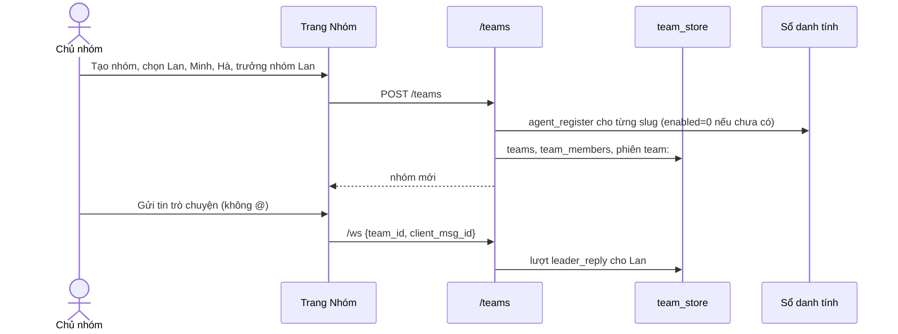
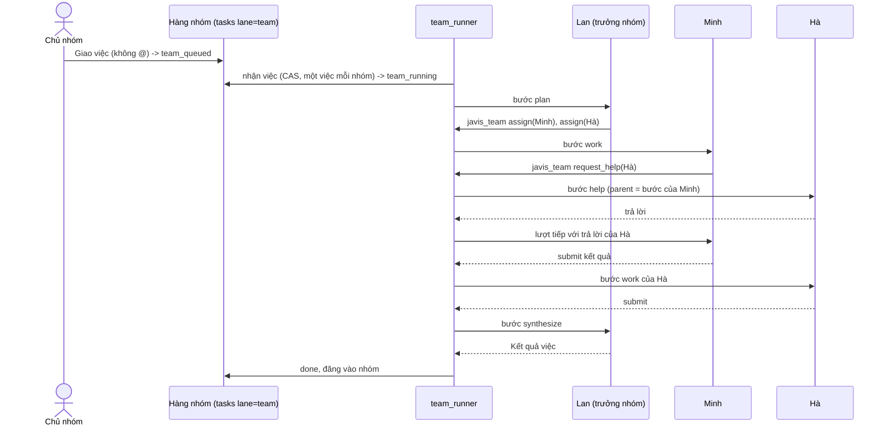
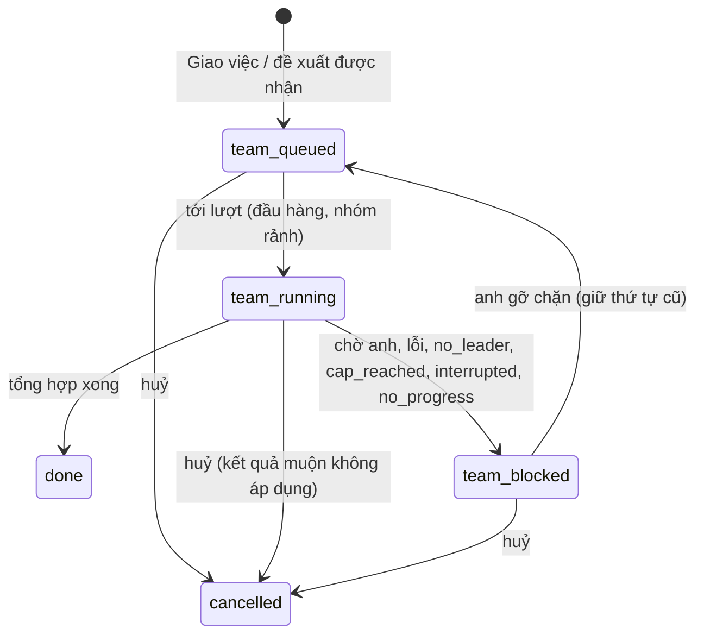

# Nhóm chat team: wireframe và sơ đồ (13/10/2026)

Đi kèm [thiết kế nhóm chat team](../superpowers/specs/2026-10-13-team-chat-design.md). Đây là wireframe nhẹ để thống nhất bố cục và trạng thái, không phải bản vẽ cuối.
- Chữ trên màn hình có khoá i18n ở cả `vi.json` và `en.json`.
- Màu không phải nơi duy nhất mang trạng thái: mọi trạng thái đều có chữ.

## 1. Desktop: trang Nhóm

```
+----------------------+------------------------------------------------+--------------------------+
| NHÓM          [+ Tạo]| Ra mắt sản phẩm 11/2           [Lọc việc v] [⚙]| Cài đặt nhóm             |
| [Tìm nhóm........ ]  | Trưởng nhóm: Lan (điều phối) · 4 thành viên    | [Thành viên][Việc][Lượt] |
|----------------------|------------------------------------------------|  [Cài đặt]               |
| ● Ra mắt sản phẩm  2 | 10:02  Anh                                     |--------------------------|
|   Lan đang tổng hợp  |        Giao việc: soạn kế hoạch ra mắt         | ĐANG LÀM                 |
|   2 việc chờ anh     |        [Việc #12]                              |  #12 Soạn kế hoạch ra mắt|
| ○ Nội dung tuần      | 10:02  (ảnh) Lan · Lập kế hoạch · #12          |   Lan điều phối · bước 3/5|
|   Minh: đã xong      |        Chia 2 phần: Minh viết thông điệp,      |   [Sửa yêu cầu] [Huỷ]    |
| ○ Báo cáo tháng      |        Hà làm lịch đăng.                       | CHỜ (theo thứ tự chạy)   |
|                      | 10:05  (ảnh) Minh · Làm · #12   ✓ Xong         |  1 ★ #14 Bảng giá   [Bỏ ★]|
|                      |        Thông điệp chính: ...                   |  2   #13 Ảnh bìa   [★ Ưu tiên]|
|                      |        😂 1                                     | BỊ CHẶN / CHỜ ANH        |
|                      | 10:06  (ảnh) Hà · Làm · #12    ⏳ Đang làm      |  #11 Kịch bản video      |
|                      |        ...                                      |   Chờ anh trả lời: thiếu |
|                      |                                                |   ngày quay  [Trả lời]   |
|                      |------------------------------------------------| LỊCH SỬ (xem thêm)       |
|                      | Đang làm: #12 Soạn kế hoạch  [Sửa yêu cầu][Huỷ]|                          |
| [Trang sau]          | [ ] Giao việc   @Minh ...............  [Gửi]  |                          |
+----------------------+------------------------------------------------+--------------------------+
```

- **Cột trái:** danh sách nhóm phân trang. Mỗi dòng có trạng thái ngắn và số việc chờ anh.
- **Cột giữa:**
  - mỗi tin có tên, ảnh, vai trong việc, nhãn việc (bấm được) và trạng thái;
  - "Lọc việc" chỉ hiện tin của một việc.
- **Cột phải:** cài đặt nhóm. Trên màn dưới 1060px thành ngăn kéo, như trang Cộng sự.
- **Thứ tự hàng chờ:** đánh số đúng thứ tự sẽ chạy. Dấu ★ kèm chữ "Ưu tiên" trên nút và trong tooltip, không chỉ là màu.

## 2. Màn hẹp (375px)

```
 Trang 1: Danh sách nhóm      Trang 2: Khung chat            Trang 3: Cài đặt nhóm (trượt lên)
+-------------------------+  +-------------------------+    +-------------------------+
| Nhóm             [+]    |  | < Ra mắt sản phẩm   [⚙] |    | Cài đặt nhóm        [x] |
| [Tìm nhóm.......]       |  | Lan điều phối · 4 người |    | [Thành viên] [Việc]     |
|-------------------------|  |-------------------------|    | [Lượt] [Cài đặt]        |
| ● Ra mắt sản phẩm    2  |  | Anh                     |    |-------------------------|
|   2 việc chờ anh        |  |  Giao việc: soạn ...    |    | ĐANG LÀM                |
| ○ Nội dung tuần         |  | Lan · Lập kế hoạch #12  |    |  #12 Soạn kế hoạch      |
| ○ Báo cáo tháng         |  |  Chia 2 phần ...        |    |  [Sửa] [Huỷ]            |
|                         |  | Minh · Làm #12 ✓        |    | CHỜ                     |
|                         |  |  ...      (giữ để chọn  |    |  1 ★ #14 Bảng giá       |
|                         |  |            reaction)    |    |      [Bỏ ưu tiên]       |
|                         |  |-------------------------|    |  2   #13 Ảnh bìa        |
|                         |  | Đang làm #12 [Sửa][Huỷ] |    |      [Ưu tiên]          |
|                         |  | [Giao việc] @..  [Gửi]  |    | BỊ CHẶN                 |
+-------------------------+  +-------------------------+    +-------------------------+
```

- Một cột; không cuộn ngang. Nút tối thiểu 44px.
- Khung soạn cố định ở đáy và tránh bàn phím ảo (mẫu `mobile-chat.js`).

## 3. Khung soạn, @ và Giao việc

```
+------------------------------------------------------------------+
| Đang làm: #12 Soạn kế hoạch ra mắt         [Sửa yêu cầu] [Huỷ]   |
|------------------------------------------------------------------|
| [ ] Giao việc   Viết giúp anh @Mi|                       [Gửi]  |
|                 +-----------------------------+                   |
|                 | (ảnh) Minh  · Viết nội dung |  <- gợi ý thành viên|
|                 | (ảnh) Mi Hà · Thiết kế      |     đang hoạt động  |
|                 +-----------------------------+                   |
+------------------------------------------------------------------+
 Khi bật "Giao việc": nút Gửi thành "Giao việc", dưới khung hiện:
 "Tạo 1 việc · giao cho Minh · vào cuối hàng (vị trí 3)"
```

- Chọn từ gợi ý thì @ thành thẻ có mã thành viên. Gõ tay "@abc" mà không chọn thì chỉ là chữ.
- Quá 3 @ (hay trần đang đặt): nút Gửi tắt, chữ báo trần.

## 4. Tin, kết quả, trạng thái

```
(ảnh) Hà · Làm · Việc #12                         ⏳ Đang làm
(ảnh) Hà · Làm · Việc #12                         ✓ Xong
(ảnh) Hà · Hỗ trợ Minh · Việc #12                 ✓ Xong
(ảnh) Lan · Tổng hợp · Việc #12        [Kết quả việc]  ✓ Xong
(ảnh) Minh · Làm · Việc #12            ⚠ Đến sau khi huỷ, không áp dụng
(ảnh) Minh · Làm · Việc #12            ⚠ Theo yêu cầu cũ (bản 1), không áp dụng
(ảnh) Minh · Làm · Việc #12            ✕ Lỗi: engine hết giờ   [Chạy lại bước]
 Hệ thống · Việc #12 chạm trần 12 lượt. [Cho thêm lượt] [Huỷ việc]
 Hệ thống · Nhóm chưa có trưởng nhóm. @ một thành viên để hỏi trực tiếp. [Chọn trưởng nhóm]
 Hệ thống · Minh đang làm ở nhóm "Nội dung tuần", sẽ trả lời sau.
 (thẻ) Lan đề xuất giao việc: "Làm bảng giá"   [Tạo việc] [Bỏ qua]
```

## 5. Sáu reaction

**Desktop:** rê chuột vào tin của agent thì hiện nút mặt cười ở góc tin.

```
 (ảnh) Minh · Làm · #12  ✓ Xong                               [☺]
 Thông điệp chính: ...
   +----------------------------------------------+
   | 👍  ❤️  😂  😮  😢  😡                         |
   | Thích Tim Haha Wow Huhu Phẫn nộ (tooltip)    |
   | [+ Lý do / góp ý]                            |
   +----------------------------------------------+
 Dưới tin sau khi chọn:  😂 1   (bấm để đổi hay bỏ)
```

**Điện thoại:** nhấn giữ tin.

```
+-----------------------------------------+
|  👍    ❤️    😂    😮    😢    😡         |   <- mỗi ô >= 44px
| Thích  Tim  Haha  Wow  Huhu  Phẫn nộ    |
|-----------------------------------------|
| Lý do (không bắt buộc, chọn nhiều):     |
| [Đúng ý] [Sai dữ kiện] [Thiếu ý]        |
| [Quá dài] [Khó hiểu] [Lạc đề]           |
| Góp ý: [..............................] |
|                       [Bỏ reaction] [Lưu]|
+-----------------------------------------+
```

- Sáu emoji luôn hiện đủ; lý do và góp ý là phần thêm.
- Chọn lại emoji đang chọn là bỏ.

## 6. Cài đặt nhóm

### 6.1 Thành viên

```
THÀNH VIÊN (4)                                           [+ Thêm] [+ Tạo agent mới]
(ảnh) Lan     Trưởng nhóm   Cộng hưởng: Bật  [công tắc]   [Đổi trưởng nhóm] [Bỏ khỏi nhóm]
(ảnh) Minh    Thành viên    Cộng hưởng: Tắt  [công tắc]   [Đặt làm trưởng nhóm] [Bỏ khỏi nhóm]
(ảnh) Hà      Thành viên    Cộng hưởng: Cần xác nhận (mở trang Cộng sự)
(ảnh) Tú      Đã xoá khỏi Jarvis 007 · 1 việc chuyển về chờ giao lại
```

- **Công tắc ở đây** gọi cùng route với trang Cộng sự. Chỉ báo xong khi server xác nhận.
- **"Bỏ khỏi nhóm"** với người đang làm hiện hộp xác nhận: "Minh đang làm bước 2 của việc #12. Bỏ ra thì bước này không được áp dụng; trưởng nhóm sẽ giao lại."
- **"+ Thêm"** mở danh sách agent của brain, lọc theo tag. Tag chỉ để lọc, không tự thêm ai.

### 6.2 Cài đặt và Toàn quyền

```
CÀI ĐẶT (một cột, nút Lưu ở cuối)
Tên nhóm      [Ra mắt sản phẩm 11/2      ]
Mô tả         [...........................]
Trạng thái    (•) Đang chạy  ( ) Tạm dừng  ( ) Lưu trữ
Trưởng nhóm   [Lan v]
Quyền của trưởng nhóm
  (•) Quyền giới hạn: điều phối trong việc anh giao; việc mới, thêm người cần anh bấm
  ( ) Toàn quyền  -> mở hộp cấp quyền
TRẦN (Quyền giới hạn: dùng mặc định)
  Lượt model mỗi việc        12
  Bước mỗi việc               8
  Lượt mỗi nhóm mỗi ngày    100  (hôm nay đã dùng 37)
                                                    [Lưu]
```

```
HỘP CẤP TOÀN QUYỀN CHO LAN
Phạm vi: chỉ trong nhóm "Ra mắt sản phẩm 11/2"
Lan được:  [x] Thêm, bỏ thành viên   [x] Tạo agent mới (agent mới do nhóm quản lý)
           [x] Đổi thứ tự việc chờ   [ ] Được ngắt việc đang chạy
           [x] Bật, tắt Cộng hưởng cho agent do nhóm quản lý
           [ ] Duyệt quyền ghi trong thư mục:  [Teams/ra-mat/      ] (D4)
Agent do nhóm quản lý: Minh [x]  Hà [ ]   (Lan sửa được lời nhắc, model, Cộng hưởng của các agent này;
                       agent đang ở nhóm khác: hiện danh sách nhóm bị ảnh hưởng)
Provider, model được dùng: [x] Claude (gói thuê bao)  [ ] OpenAI API (trả phí)
TRẦN TRẦN (Lan chỉnh được trong mức này)
  Lượt model mỗi việc    ( ) Số [  ]  (•) Không giới hạn
  Bước mỗi việc          (•) Số [ 20 ] ( ) Không giới hạn
  Lượt mỗi nhóm mỗi ngày ( ) Số [  ]  (•) Không giới hạn
  Việc chạy cùng lúc     (•) Số [ 1 ]
Luôn áp, không bỏ được: hạn mức gói thuê bao và nhà cung cấp; trần máy chủ JAVIS_RESONANCE_CALL_CEILING
(chỉ cho mục tiêu Cộng hưởng); dừng, huỷ, thu hồi của anh; cổng review A5.
Vòng không tiến triển: luôn phát hiện; với "Không giới hạn" thì tạm dừng việc và báo anh.
                                            [Huỷ]  [Cấp Toàn quyền]
```

### 6.3 Lượt

```
LƯỢT (7 ngày)          Hôm nay 37 / 100
Theo việc: #12  9 lượt · 41k token vào · 3k ra
Theo agent: Lan 14 · Minh 12 · Hà 11
Theo vai: Trả lời 10 · Lập kế hoạch 4 · Làm 15 · Hỗ trợ 3 · Tổng hợp 5
(Lượt Grok, Antigravity: có đếm, chưa có token)
```

## 7. Màn Trợ lý (Cộng sự): công tắc trên dòng

```
TRỢ LÝ                                [Tất cả agent v] [Tìm]
(ảnh) Lan        Điều phối dự án      #Marketing          Cộng hưởng: Bật  [●━]  [...]
(ảnh) Minh       Viết nội dung        #Nội dung           Cộng hưởng: Tắt  [━○]  [...]
(ảnh) Hà         Thiết kế                                 Cộng hưởng: Cần xác nhận >
```

- **Bấm công tắc:** trạng thái "Đang lưu...". Server xác nhận thì đổi; lỗi hay 409 thì tải lại và hiện lý do.
- **Tắt khi đang có việc:** hộp xác nhận "Lan có 2 mục tiêu Cộng hưởng đang mở (sẽ dừng ở bước kế) và đang ở 2 nhóm. Việc nhóm không bị dừng bởi công tắc này."
- **Trang Cài đặt** chỉ còn: "3 trợ lý đang bật Cộng hưởng · Quản lý ở trang Cộng sự >".

## 8. Sơ đồ luồng

### 8.1 Tạo nhóm tới chat (A)



### 8.2 Giao chung, phân công, tổng hợp (B) và nhờ hỗ trợ (D)



### 8.3 Trạng thái việc nhóm



### 8.4 Hàng đợi: ví dụ A, C, B

```
t0  Đang làm: A        Chờ: B(seq 2), C(seq 3)
t1  Anh bấm Ưu tiên C  -> C.team_prio = 1      Chờ: C★, B
t2  A xong             -> nhận đầu hàng: C      Đang làm: C   Chờ: B
t3  C xong             -> nhận B                Đang làm: B
A không chạy lại; C không ngắt A.
```
