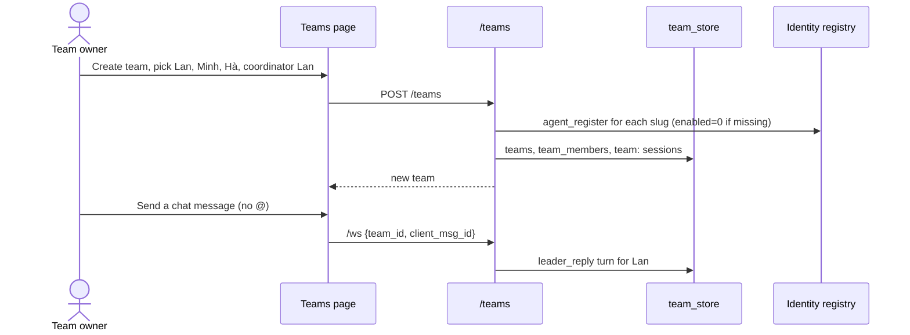
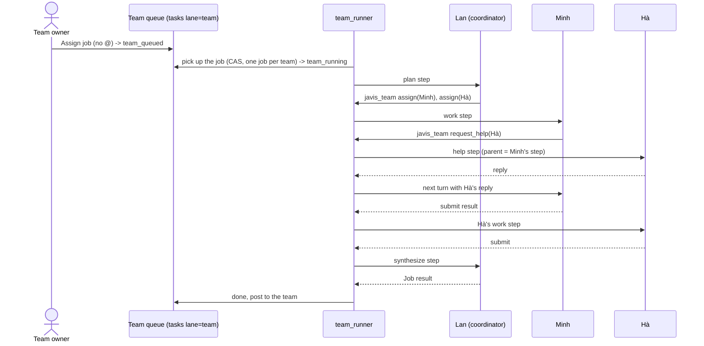
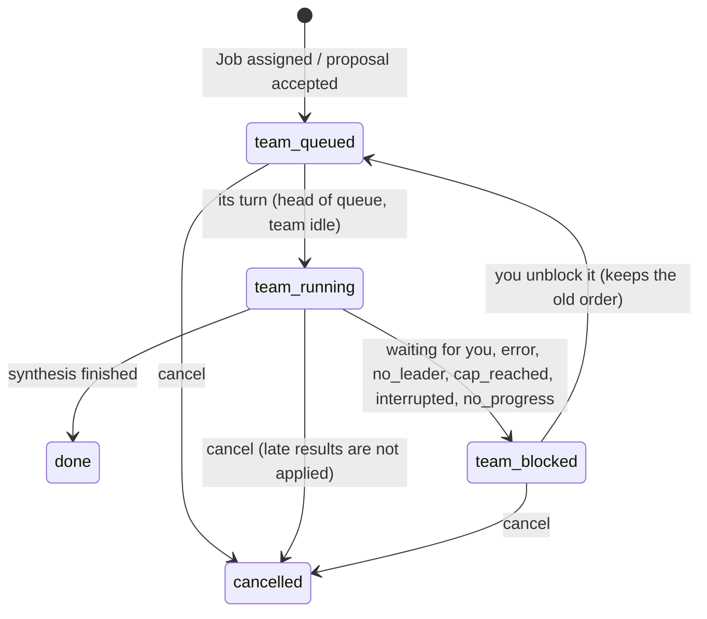

# Team chat: wireframes and diagrams (13/10/2026)

Companion to the [team chat design](../superpowers/specs/2026-10-13-team-chat-design.md). These are light wireframes to agree on layout and states, not final artwork.
- Every piece of on-screen text has an i18n key in both `vi.json` and `en.json`.
- Color is never the only carrier of a state: every state also has text.

## 1. Desktop: the Teams page

```
+----------------------+------------------------------------------------+--------------------------+
| TEAMS         [+ New]| Product launch 11/2          [Filter jobs v] [⚙]| Team settings            |
| [Search teams.... ]  | Coordinator: Lan (leads) · 4 members           | [Members][Jobs][Turns]   |
|----------------------|------------------------------------------------|  [Settings]              |
| ● Product launch   2 | 10:02  You                                     |--------------------------|
|   Lan is compiling   |        Assign job: draft the launch plan       | WORKING ON               |
|   2 jobs wait on you |        [Job #12]                               |  #12 Draft launch plan   |
| ○ Weekly content     | 10:02  (photo) Lan · Planning · #12            |   Lan leads · step 3/5   |
|   Minh: done         |        Splits in 2: Minh writes the message,   |   [Edit request] [Cancel]|
| ○ Monthly report     |        Hà builds the posting schedule.         | WAITING (in run order)   |
|                      | 10:05  (photo) Minh · Work · #12   ✓ Done      |  1 ★ #14 Price list [Unprioritize]|
|                      |        Main message: ...                       |  2   #13 Cover art [★ Prioritize]|
|                      |        😂 1                                     | BLOCKED / WAITING FOR YOU|
|                      | 10:06  (photo) Hà · Work · #12    ⏳ Working    |  #11 Video script        |
|                      |        ...                                      |   Waiting for your answer: |
|                      |                                                |   shoot date missing [Reply]|
|                      |------------------------------------------------| HISTORY (see more)       |
|                      | Working on: #12 Draft plan  [Edit request][Cancel]|                        |
| [Next page]          | [ ] Assign job   @Minh ...............  [Send]  |                          |
+----------------------+------------------------------------------------+--------------------------+
```

- **Left column:** paginated team list. Each row has a short status and the number of jobs waiting on you.
- **Middle column:**
  - each message shows the name, photo, role in the job, job tag (clickable) and status;
  - "Filter jobs" shows only the messages of one job.
- **Right column:** team settings. Below 1060px wide it becomes a drawer, like the Partners page.
- **Queue order:** numbered in the exact order jobs will run. The ★ comes with the word "Prioritize" on the button and in the tooltip, not just color.

## 2. Narrow screen (375px)

```
 Page 1: Team list             Page 2: Chat pane              Page 3: Team settings (slides up)
+-------------------------+  +-------------------------+    +-------------------------+
| Teams            [+]    |  | < Product launch    [⚙] |    | Team settings       [x] |
| [Search teams...]       |  | Lan leads · 4 people    |    | [Members] [Jobs]        |
|-------------------------|  |-------------------------|    | [Turns] [Settings]      |
| ● Product launch     2  |  | You                     |    |-------------------------|
|   2 jobs wait on you    |  |  Assign job: draft ...  |    | WORKING ON              |
| ○ Weekly content        |  | Lan · Planning #12      |    |  #12 Draft plan         |
| ○ Monthly report        |  |  Splits in 2 ...        |    |  [Edit] [Cancel]        |
|                         |  | Minh · Work #12 ✓       |    | WAITING                 |
|                         |  |  ...      (hold to pick |    |  1 ★ #14 Price list     |
|                         |  |            a reaction)  |    |      [Unprioritize]     |
|                         |  |-------------------------|    |  2   #13 Cover art      |
|                         |  | Working on #12 [Edit][Cancel]|      [Prioritize]      |
|                         |  | [Assign job] @..  [Send]|    | BLOCKED                 |
+-------------------------+  +-------------------------+    +-------------------------+
```

- One column; no horizontal scrolling. Buttons are at least 44px.
- The composer is pinned to the bottom and avoids the on-screen keyboard (the `mobile-chat.js` pattern).

## 3. Composer, @ and Assign job

```
+------------------------------------------------------------------+
| Working on: #12 Draft launch plan          [Edit request] [Cancel]|
|------------------------------------------------------------------|
| [ ] Assign job   Write this for me @Mi|                  [Send]  |
|                  +-----------------------------+                  |
|                  | (photo) Minh  · Content writer|  <- suggestions: |
|                  | (photo) Mi Hà · Design        |     active members|
|                  +-----------------------------+                  |
+------------------------------------------------------------------+
 When "Assign job" is on: the Send button becomes "Assign job", and below the box it shows:
 "Create 1 job · assign to Minh · at the end of the queue (position 3)"
```

- Picking from the suggestions turns the @ into a chip carrying the member id. Typing "@abc" by hand without picking is just text.
- More than 3 @ (or whatever ceiling is set): Send is disabled and the text states the ceiling.

## 4. Messages, results, states

```
(photo) Hà · Work · Job #12                         ⏳ Working
(photo) Hà · Work · Job #12                         ✓ Done
(photo) Hà · Helping Minh · Job #12                 ✓ Done
(photo) Lan · Synthesis · Job #12      [Job result]  ✓ Done
(photo) Minh · Work · Job #12          ⚠ Arrived after cancel, not applied
(photo) Minh · Work · Job #12          ⚠ Based on the old request (version 1), not applied
(photo) Minh · Work · Job #12          ✕ Error: engine timed out   [Re-run step]
 System · Job #12 hit the 12-turn ceiling. [Allow more turns] [Cancel job]
 System · The team has no coordinator. @ a member to ask directly. [Pick a coordinator]
 System · Minh is working in the team "Weekly content" and will reply later.
 (card) Lan suggests assigning a job: "Make the price list"   [Create job] [Skip]
```

## 5. The six reactions

**Desktop:** hover over an agent's message and a smiley button appears at the corner of the message.

```
 (photo) Minh · Work · #12  ✓ Done                            [☺]
 Main message: ...
   +----------------------------------------------+
   | 👍  ❤️  😂  😮  😢  😡                         |
   | Like Love Haha Wow Sad Angry (tooltip)       |
   | [+ Reason / comment]                         |
   +----------------------------------------------+
 Under the message after picking:  😂 1   (click to change or remove)
```

**Phone:** long-press the message.

```
+-----------------------------------------+
|  👍    ❤️    😂    😮    😢    😡         |   <- each cell >= 44px
| Like  Love  Haha  Wow  Sad  Angry       |
|-----------------------------------------|
| Reasons (optional, pick any):           |
| [On point] [Wrong facts] [Missing points]|
| [Too long] [Unclear] [Off topic]        |
| Comment: [............................] |
|                 [Remove feedback] [Save]|
+-----------------------------------------+
```

- All six emoji are always shown; reasons and comment are optional extras.
- Picking the emoji that is already selected removes it.

## 6. Team settings

### 6.1 Members

```
MEMBERS (4)                                              [+ Add] [+ Create new agent]
(photo) Lan     Coordinator  Resonance: On  [switch]   [Change coordinator] [Remove from team]
(photo) Minh    Member       Resonance: Off [switch]   [Make coordinator] [Remove from team]
(photo) Hà      Member       Resonance: Needs confirmation (opens the Partners page)
(photo) Tú      Deleted from Jarvis 007 · 1 job moved back to wait for reassignment
```

- **The switch here** calls the same route as the Partners page. It reports done only once the server confirms.
- **"Remove from team"** on someone who is working shows a confirmation box: "Minh is working on step 2 of job #12. If you remove him, this step is not applied; the coordinator will reassign it."
- **"+ Add"** opens the brain's agent list, filtered by tag. A tag is only for filtering and never adds anyone by itself.

### 6.2 Settings and Full access

```
SETTINGS (one column, Save button at the bottom)
Team name     [Product launch 11/2       ]
Description   [...........................]
Status        (•) Active  ( ) Paused  ( ) Archived
Coordinator   [Lan v]
Coordinator permissions
  (•) Limited: coordinates inside the jobs you assign; new jobs and adding people need your tap
  ( ) Full access  -> opens the grant box
CEILINGS (Limited: use the defaults)
  Model turns per job          12
  Steps per job                 8
  Turns per team per day      100  (37 used today)
                                                    [Save]
```

```
GRANT FULL ACCESS TO LAN
Scope: only inside the team "Product launch 11/2"
Lan may:   [x] Add and remove members   [x] Create new agents (new agents are managed by the team)
           [x] Reorder waiting jobs     [ ] Interrupt a running job
           [x] Turn Resonance on and off for team-managed agents
           [ ] Approve write access in folder:  [Teams/launch/      ] (D4)
Team-managed agents: Minh [x]  Hà [ ]   (Lan can edit the prompt, model and Resonance of these agents;
                       an agent that is in another team: shows the list of affected teams)
Providers and models allowed: [x] Claude (subscription plan)  [ ] OpenAI API (pay as you go)
CEILING OF CEILINGS (Lan can adjust within this range)
  Model turns per job    ( ) Number [  ]  (•) Unlimited
  Steps per job          (•) Number [ 20 ] ( ) Unlimited
  Turns per team per day ( ) Number [  ]  (•) Unlimited
  Jobs running at once   (•) Number [ 1 ]
Always applied, cannot be removed: subscription plan and provider quotas; the server ceiling JAVIS_RESONANCE_CALL_CEILING
(for Resonance goals only); your own stop, cancel and revoke; the A5 review gate.
No-progress loops: always detected; with "Unlimited" the job is paused and you are told.
                                            [Cancel]  [Grant Full access]
```

### 6.3 Turns

```
TURNS (7 days)          Today 37 / 100
By job: #12  9 turns · 41k tokens in · 3k out
By agent: Lan 14 · Minh 12 · Hà 11
By role: Reply 10 · Planning 4 · Work 15 · Help 3 · Synthesis 5
(Grok and Antigravity turns: counted, no tokens yet)
```

## 7. Assistants page (Partners): switch on the row

```
ASSISTANTS                            [All agents v] [Search]
(photo) Lan      Project coordinator  #Marketing        Resonance: On  [●━]  [...]
(photo) Minh     Content writer       #Content          Resonance: Off [━○]  [...]
(photo) Hà       Designer                               Resonance: Needs confirmation >
```

- **Clicking the switch:** the state reads "Saving...". It changes when the server confirms; on an error or a 409 the page reloads and shows the reason.
- **Turning it off while there is work:** a confirmation box, "Lan has 2 open Resonance goals (they stop at the next step) and is in 2 teams. Team jobs are not stopped by this switch."
- **The Settings page** keeps only: "3 assistants have Resonance on · Manage on the Partners page >".

## 8. Flow diagrams

### 8.1 Creating a team to chat (A)



### 8.2 Shared assignment, delegation, synthesis (B) and asking for help (D)



### 8.3 Team job states



### 8.4 Queue: example A, C, B

```
t0  Working: A         Waiting: B(seq 2), C(seq 3)
t1  You tap Prioritize on C  -> C.team_prio = 1      Waiting: C★, B
t2  A finishes         -> take the head of the queue: C      Working: C   Waiting: B
t3  C finishes         -> take B                Working: B
A does not run again; C does not interrupt A.
```
